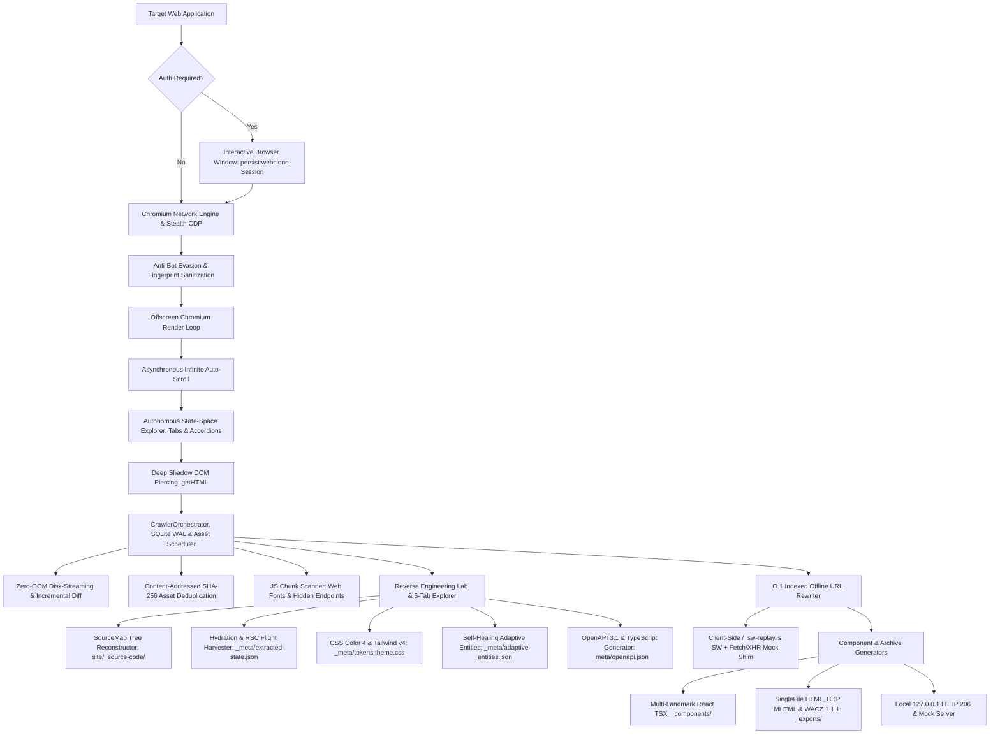
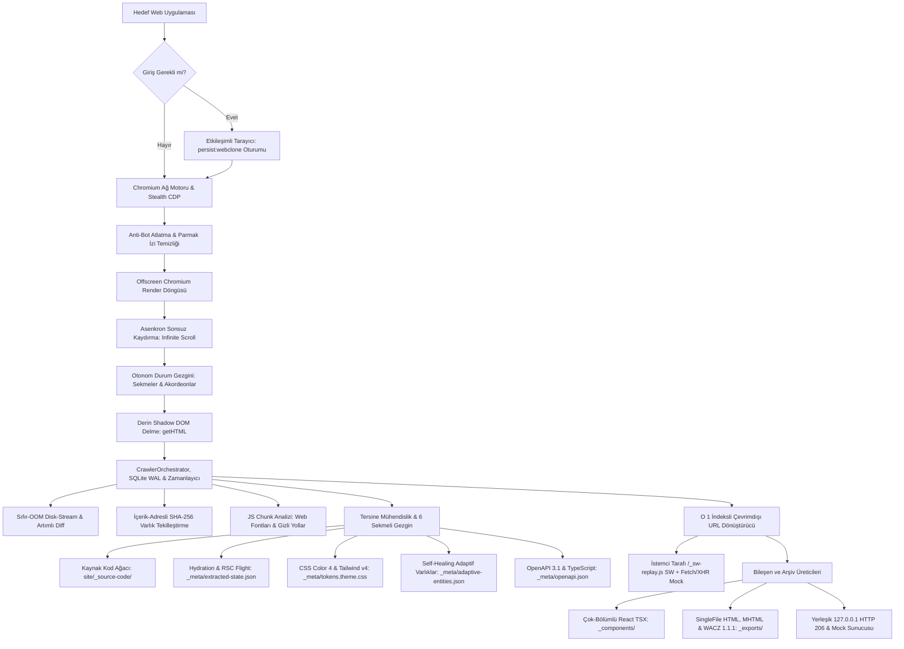

# WebClone Studio

<div align="center">


<br/><br/>

**Enterprise Web Architecture Extraction, Lossless Offline Mirroring & Reverse Engineering Workstation**

[](https://github.com/MonarchDevLab/WebClone-Studio/releases)
[](https://github.com/MonarchDevLab/WebClone-Studio/releases/latest)
[](#)
[](#)
[](#)
[](#)
[](#)
[](#)
[](https://github.com/MonarchDevLab/WebClone-Studio/stargazers)
[](https://github.com/MonarchDevLab/WebClone-Studio)

*Developed by Monolith Works | Published via MonarchDevLab*

<br/>

[ **English Documentation** ](#english-documentation) &nbsp;&bull;&nbsp; [ **Türkçe Dokümantasyon** ](#türkçe-dokümantasyon)

</div>

---

# English Documentation

## Table of Contents
- [Executive Overview](#executive-overview)
- [Architecture & Engine Pipeline](#architecture--engine-pipeline)
- [Deep Technical Capabilities](#deep-technical-capabilities)
  - [1. Autonomous State-Space Explorer](#1-autonomous-state-space-explorer)
  - [2. Declarative Shadow DOM Piercing](#2-declarative-shadow-dom-piercing)
  - [3. Frontend Reverse Engineering Lab](#3-frontend-reverse-engineering-lab)
  - [4. API Traffic Interception to OpenAPI 3.1 & TypeScript](#4-api-traffic-interception-to-openapi-31--typescript)
  - [5. React 19 Component Exporter](#5-react-19-component-exporter)
  - [6. Dual Standalone Archive: SingleFile HTML & Native CDP MHTML](#6-dual-standalone-archive-singlefile-html--native-cdp-mhtml)
  - [7. Persistent Auth Session for Authenticated Portals](#7-persistent-auth-session-for-authenticated-portals)
  - [8. Client-Side Offline Fetch & XHR Mock Shim](#8-client-side-offline-fetch--xhr-mock-shim)
  - [9. Zero-OOM Disk-Streaming Pipeline & SHA-256 Deduplication](#9-zero-oom-disk-streaming-pipeline--sha-256-deduplication)
  - [10. O(1) Local URL Rewriter](#10-o1-local-url-rewriter)
  - [11. JavaScript Obfuscation Bypass](#11-javascript-obfuscation-bypass)
  - [12. Embedded 127.0.0.1 Micro-Preview & Mock Server](#12-embedded-127001-micro-preview--mock-server)
  - [13. Ultra-Stealth CDP Anti-Bot Evasion & Clearance Bridge](#13-ultra-stealth-cdp-anti-bot-evasion--clearance-bridge)
  - [14. Self-Healing Adaptive Semantic Extractor](#14-self-healing-adaptive-semantic-extractor)
  - [15. GitHub Releases Auto-Update Hub](#15-github-releases-auto-update-hub)
- [Workstation Benchmark & Comparison](#workstation-benchmark--comparison)
- [Distribution Formats & Installation](#distribution-formats--installation)
- [Developer Setup & Build Commands](#developer-setup--build-commands)
- [Legal & Copyright](#legal--copyright)

---

## Executive Overview

**WebClone Studio** is an enterprise-grade desktop workstation designed for web architects, reverse engineers, security analysts, and senior frontend developers. Rather than merely downloading static assets like legacy crawlers, WebClone Studio operates as an autonomous digital reconstruction laboratory:

1. **Complete Offline Mirroring:** Crawls, resolves, and rewrites complex Single Page Applications (Next.js App Router/RSC, Nuxt, Remix, Vite, Angular) and multi-page portals with `/_sw-replay.js` Service Worker, HTTP `206` Range media streaming, and SQLite WAL crash-safe checkpoint recovery.
2. **Reverse Engineering Decompilation:** Reconstructs original development file trees from production source maps, extracts hydration and Next.js RSC Flight states, outputs CSS Color 4 (`oklch`/`oklab`/`display-p3`) & Tailwind v4 `@theme` tokens, inspects everything in a 6-tab Artifact Explorer, and compiles OpenAPI 3.1 specifications.
3. **Modular Code Generation:** Synthesizes multi-landmark React 19 TSX components, exports self-contained SingleFile HTML, Chromium MHTML, and standard WACZ 1.1.1 archives (`_exports/*.wacz`).
4. **Persistent Authenticated Crawling:** Enables isolated per-domain browser login sessions (`persist:webclone_<sha256>`), allowing seamless user-driven sign-in and cookie inheritance across both Chromium and BoringSSL `session.fetch` downloads.
5. **Zero-Driver Embedded Runtime:** Embeds Chromium 156 + Node 24.22 (`node:sqlite`) directly within Electron 45, eliminating external browser or native C++ (`node-gyp`) dependencies.
6. **Zero-OOM Crash-Safe Architecture:** Streams raw HTML directly to disk, indexes URL mappings in $O(1)$ time, and checkpoints queues in built-in SQLite WAL for resume and ETag/SHA-256 incremental diffing.

<br/>

<p align="center">
  
</p>

---

## Architecture & Engine Pipeline

The system is organized around a multi-stage cognitive extraction and reconstruction pipeline:



---

## Deep Technical Capabilities

### 1. Autonomous State-Space Explorer
Traditional scrapers only capture the initial DOM state, missing up to 70% of modern dynamic interfaces. WebClone Studio executes an autonomous interaction loop:
- **Heuristic Safe Interaction:** Scans the active DOM for unopened accordions, hidden FAQ panels, unselected tabs, and expandable menus (`[role="tab"][aria-selected="false"]`, `details:not([open]) > summary`, `[aria-expanded="false"]`, `.accordion-header`, `.faq-question`).
- **Destructive Action Isolation:** Forms, submit buttons, delete/logout triggers, and external navigation links (`<a>`) are strictly filtered out to prevent state mutation or page divergence.
- **Micro-Debounced Clicks:** Sequentially simulates native user click events with debounced intervals to allow CSS transitions and dynamic lazy-loaded contents to fully populate the DOM before snapshot capture.

### 2. Declarative Shadow DOM Piercing
Web components built with Stencil, Lit, or native Custom Elements encapsulate their DOM within Shadow Roots, leaving standard `outerHTML` dumps empty:
- **Chromium Native Serialization:** Leverages `element.getHTML({ serializableShadowRoots: true })` directly within Electron 45 Chromium 156.
- **W3C Declarative Format:** Serializes nested shadow trees into standard `<template shadowrootmode="open">` elements, enabling any modern Chromium browser to render encapsulated components offline with zero JavaScript overhead.

### 3. Frontend Reverse Engineering Lab
- **SourceMap Virtual Tree Reconstructor:** Scans all JS and CSS bundles for `sourceMappingURL` directives (relative, absolute, or data URIs). It resolves and asynchronously decodes `.map` files safely into `site/_source-code/` (preserving parent relative modules under `_up_/` without path escape).
- **Framework Hydration Harvester:** Captures server-rendered hydration and RSC states (`window.__NEXT_DATA__`, Next.js App Router `self.__next_f.push` payloads, `window.__NUXT_DATA__`, `window.__INITIAL_STATE__`), outputting a consolidated dataset into `_meta/extracted-state.json`.
- **Design Tokens & Tailwind v4 `@theme`:** Aggregates `:root` CSS variables, CSS Color 4 (`oklch()`, `oklab()`, `color(display-p3 ...)`), luminance-aware roles, typography scales, and box shadows into `_meta/design-tokens.json`, `_meta/tailwind.config.js`, and `_meta/tokens.theme.css`.

### 4. API Traffic Interception to OpenAPI 3.1 & TypeScript
- **CDP Network Hooking:** Connects to Chrome DevTools Protocol (`Network.enable`) to capture all background asynchronous requests (XHR, Fetch, JSON responses).
- **OpenAPI 3.1 Contract Generation:** Infers JSON schemas, request query parameters, and HTTP response statuses to compile a production-ready `_meta/openapi.json` (Swagger) contract.
- **TypeScript Type Definitions:** Compiles strongly typed TypeScript interfaces for each endpoint into `_meta/api-types.d.ts`. Example output:

```typescript
/**
 * Endpoint: GET /api/v1/products
 * Status: 200
 */
export interface GetApiV1ProductsResponse {
  products?: { id?: number; title?: string; price?: number; inStock?: boolean }[];
  totalCount?: number;
  page?: number;
}
```

### 5. React 19 Component Exporter
- Converts multi-landmark cloned HTML sections (`header`, `main`, `section`, `footer`) into typed React functional components (`_components/PageSection*.tsx`).
- Converts HTML attributes (`class` to `className`, `for` to `htmlFor`).
- Translates inline style strings into valid TypeScript style objects (`style="margin-top: 10px; z-index: 5;"` -> `style={{ marginTop: '10px', zIndex: 5 }}`).
- Translates SVG attributes to camelCase (`stroke-width` -> `strokeWidth`, `fill-rule` -> `fillRule`).
- Formats self-closing tags (``, `<input>`, `<br>`, `<hr>`).

### 6. Dual Standalone Archive: SingleFile HTML & Native CDP MHTML
WebClone Studio delivers two complementary standalone archive formats:
- **SingleFile Portable HTML (`_exports/index.standalone.html`):** Inlines stylesheets into `<style>` blocks, converts web fonts into Base64 Data URIs (`url("data:font/woff2;base64,...")`), and encodes all images and vector icons as inline Data URIs.
- **Native CDP MHTML Snapshot (`_exports/index.mhtml`):** Calls Chromium DevTools Protocol `Page.captureSnapshot({ format: 'mhtml' })` on the live rendered DOM. It produces an uncompressed MIME multipart HTML archive containing the exact render tree, canvas elements, and dynamically fetched sub-resources, viewable natively in Google Chrome, Microsoft Edge, and Opera with zero dependencies.

### 7. Persistent Auth Session for Authenticated Portals
Cloning password-protected web apps, SaaS dashboards, or sites protected by 2FA/CAPTCHA is handled natively:
- **Interactive Authentication Hub:** The Clone Setup Wizard offers an interactive login window powered by a shared `persist:webclone` session partition.
- **Cookie & LocalStorage Synchronization:** Users authenticate manually in the secure browser window; once closed, the engine harvests active session cookies, bearer tokens, and clearance tickets.
- **Dual-Engine Inheritance:** Both the Chromium offscreen renderer (`PageRenderer`) and the multi-threaded HTTP downloader (`AssetDownloader`) inherit the session, enabling authenticated asset mirroring.

### 8. Client-Side Offline Fetch & XHR Mock Shim
Modern Single Page Applications break offline when JavaScript code triggers runtime `fetch()` or `axios` calls against external origin APIs:
- **Client-Side Mock Injection:** During HTML rewriting, WebClone Studio injects an XSS-sanitized runtime shim (`window.fetch` interceptor) right alongside the offline Service Worker bypass.
- **Zero-Latency Mock Resolution:** When cloned client scripts query endpoints recorded in `_meta/api-endpoints.json`, the browser intercepts the request and instantly responds with the recorded JSON payload, keeping interactive search, filtering, and tab navigation working without an active internet connection.

### 9. Zero-OOM Disk-Streaming Pipeline & SHA-256 Deduplication
- **Immediate Disk-Streaming:** Rather than buffering gigabytes of raw HTML across hundreds of pages in process memory, pages are immediately written to disk upon retrieval. The rewrite queue stores lightweight pointers (`{ url, localPath }`), slashing heap memory consumption by over 90%.
- **Content-Addressed SHA-256 Deduplication:** Assets under 15MB are hashed via SHA-256. Duplicate vendor scripts, logos, or icon sets hosted across divergent URLs are deduplicated to a single physical disk file, with all local references transparently linked.

### 10. O(1) Local URL Rewriter
- **Indexed Map Resolution:** Replaces $O(N)$ sequential map scans with an indexed hash lookup that resolves exact, query-stripped, hash-stripped, and trailing-slash URL variations in $O(1)$ constant time.
- **Zero-Lock Finalization:** Thousands of internal resource references across massive crawls finalize in seconds without stalling CPU cores.

### 11. JavaScript Obfuscation Bypass
- Heuristic AST and regex parser scans minified production JS chunks (Webpack, Vite, Rollup).
- Extracts dynamic asset paths, vendor CDN URLs, and hidden web font endpoints that are never linked directly in HTML or CSS.
- Automatically pushes discovered assets into the download scheduler queue.

### 12. Embedded 127.0.0.1 Micro-Preview & Mock Server
- Bundles a built-in Node.js HTTP server configured with path-traversal guards and MIME type negotiation.
- Serves cloned projects locally over `http://127.0.0.1:<port>` to eliminate browser `file:///` security and CORS errors.
- **Offline API Mock Fallback:** When the cloned frontend makes an AJAX request that has no static file on disk, the server falls back to `_meta/api-endpoints.json` to respond with the recorded JSON payload.

### 13. Ultra-Stealth CDP Anti-Bot Evasion & Clearance Bridge
- Prototype-clean descriptor masking for `navigator.webdriver`, `window.chrome` (runtime/app/csi), `navigator.permissions.query`, and realistic WebGL GPU virtualization (NVIDIA RTX / Intel Iris).
- Injects micro-jitter into Canvas and AudioContext buffers to invalidate deterministic bot fingerprint tracking without corrupting media assets.
- **Clearance Bridge:** Harvests active `cf_clearance`, `__cf_bm`, and session cookies directly from Electron's Chromium session and synchronizes them into `AssetDownloader`'s HTTP/2 connection pool.
- **Automated WAF Escalation:** Automatically promotes failed static downloads (403/503 Turnstile / Challenge pages) to the Ultra-Stealth Chromium renderer and re-syncs clearance tokens in real time.

### 14. Self-Healing Adaptive Semantic Extractor
- Analyzes heavily obfuscated and minified DOM structures (Tailwind arbitrary hashes, CSS Modules, compiled styled-components) using structural density heuristics rather than volatile CSS class names.
- Discovers primary content containers, recurring product/article cards, and pagination/infinite load triggers.
- Generates `_meta/adaptive-entities.json` containing structured entities (title, link, image, price/badge, description).

### 15. GitHub Releases Auto-Update Hub
- Built-in update service queries the official GitHub Releases API (`https://api.github.com/repos/MonarchDevLab/WebClone-Studio/releases/latest`).
- In-app Settings page displays current version, latest release notes, total download counters, and direct download links for Windows Setup, Portable, and MSI installers.

---

## Workstation Benchmark & Comparison

| Feature / Capability | WebClone Studio | HTTrack | SingleFile | Cyotek WebCopy | Raw Puppeteer Scripts |
| :--- | :---: | :---: | :---: | :---: | :---: |
| **Interactive Auth Session Vault**| Built-in (`persist:webclone`) | No | No | No | Manual script required |
| **Native CDP MHTML Snapshot** | Built-in (`_exports/`) | No | No | No | Manual script required |
| **Offline Fetch Mock Shim** | Built-in (`UrlRewriter`) | No | No | No | No |
| **Zero-OOM Disk-Streaming** | Built-in ($O(1)$ RAM) | Partial | No | Partial | Manual file streams |
| **Shadow DOM Piercing** | Full (Native CDP) | No | Partial | No | Manual script required |
| **Autonomous State Explorer** | Built-in | No | No | No | Manual script required |
| **Ultra-Stealth WAF Evasion** | Built-in (CDP + Bridge) | No | No | No | Plugin required |
| **Self-Healing Adaptive Extractor**| Built-in (`_meta/`) | No | No | No | No |
| **SourceMap Reconstruction** | Automatic | No | No | No | No |
| **OpenAPI 3.1 & TS Generator** | Built-in | No | No | No | No |
| **React 19 Component Export** | Automatic | No | No | No | No |
| **Hydration State Recovery** | Built-in | No | No | No | No |
| **Tailwind v4 Token Generator** | Built-in | No | No | No | No |
| **Offline Mock API Server** | 127.0.0.1 Built-in | No | No | No | External server needed |
| **Single-File Standalone Export**| Yes (`_exports/`) | No | Yes | No | Manual inlining |
| **External Driver Dependency** | Zero (Embedded) | None | None | None | Heavy (Chromium/Node) |
| **Distribution Formats** | Setup, Portable, MSI | Setup | Extension | Setup | CLI script only |

---

## Distribution Formats & Installation

WebClone Studio releases provide three Windows x64 distribution packages:

```
dist/
├── WebClone-Studio-Setup-2.0.0.exe    # NSIS installer with desktop shortcuts and uninstaller
├── WebClone-Studio-Portable.exe       # Standalone portable executable (98.5 MB with Chromium 156 runtime; 2.24 MB app.asar)
└── WebClone-Studio-2.0.0.msi          # Microsoft Windows Installer for enterprise GPO deployment
```

1. **Portable Edition:** Download `WebClone-Studio-Portable.exe`, place it in any folder or USB drive, and double-click to run. Requires no administrative privileges.
2. **Setup Installer:** Run `WebClone-Studio-Setup-2.0.0.exe` for standard Windows installation with Start Menu and Desktop shortcuts.
3. **MSI Package:** Suitable for enterprise system administrators deploying across domain networks via Microsoft Intune or Group Policy.

---

## Developer Setup & Build Commands

```bash
# Clone repository
git clone https://github.com/MonarchDevLab/WebClone-Studio.git
cd WebClone-Studio

# Install production and development dependencies
npm install

# Run desktop app in development mode with HMR
npm run dev

# Run strict TypeScript type verification
npm run typecheck

# Run unit and integration tests
npm test

# Run Playwright Electron E2E verification
npm run build && npm run test:e2e

# Build production bundles
npm run build

# Package portable Windows binary only
npm run build:portable

# Package NSIS setup installer only
npm run build:setup

# Package MSI Windows Installer only
npm run build:msi

# Package all Windows targets simultaneously (Setup, Portable, MSI)
npm run build:all
```

---

<br/>

# Türkçe Dokümantasyon

## İçindekiler
- [Genel Bakış](#genel-bakış-1)
- [Mimari ve Motor Boru Hattı](#mimari-ve-motor-boru-hattı)
- [Derinlemesine Teknik Yetenekler](#derinlemesine-teknik-yetenekler)
  - [1. Otonom Durum Gezgini (State Explorer)](#1-otonom-durum-gezgini-state-explorer-1)
  - [2. Declarative Shadow DOM Delme](#2-declarative-shadow-dom-delme)
  - [3. Tersine Mühendislik ve Dekompilasyon Laboratuvarı](#3-tersine-mühendislik-ve-dekompilasyon-laboratuvarı)
  - [4. Ağ Trafiğinden OpenAPI 3.1 ve TypeScript Üretimi](#4-ağ-trafiğinden-openapi-31-ve-typescript-üretimi)
  - [5. React 19 Fonksiyonel Bileşen İhracı](#5-react-19-fonksiyonel-bileşen-ihracı)
  - [6. Çift Bağımsız Arşiv: SingleFile HTML ve Native CDP MHTML](#6-çift-bağımsız-arşiv-singlefile-html-ve-native-cdp-mhtml)
  - [7. Kilitli İçerikler İçin Kalıcı Oturum Açma (persist:webclone)](#7-kilitli-içerikler-için-kalıcı-oturum-açma-persistwebclone)
  - [8. İstemci Tarafı Çevrimdışı Fetch ve XHR Mock Yakalayıcısı](#8-istemci-tarafı-çevrimdışı-fetch-ve-xhr-mock-yakalayıcısı)
  - [9. Sıfır-OOM Bellek Akışı ve SHA-256 İçerik Tekilleştirmesi](#9-sıfır-oom-bellek-akışı-ve-sha-256-içerik-tekilleştirmesi)
  - [10. O(1) Sabit Zamanlı Yerel URL Dönüştürücü](#10-o1-sabit-zamanlı-yerel-url-dönüştürücü)
  - [11. JavaScript Obfuscation Bypass (Gizli Varlık Çıkarımı)](#11-javascript-obfuscation-bypass-gizli-varlık-çıkarımı)
  - [12. Yerleşik 127.0.0.1 Önizleme ve Çevrimdışı Mock Sunucusu](#12-yerleşik-127001-önizleme-ve-çevrimdışı-mock-sunucusu)
  - [13. Ultra-Stealth CDP Anti-Bot Kalkanı ve Clearance Köprüsü](#13-ultra-stealth-cdp-anti-bot-kalkanı-ve-clearance-köprüsü)
  - [14. Self-Healing Adaptif Semantik İçerik Çıkarıcı](#14-self-healing-adaptif-semantik-içerik-çıkarıcı)
  - [15. GitHub Releases Güncelleme Merkezi](#15-github-releases-güncelleme-merkezi-1)
- [Karşılaştırma ve Başarım Tablosu](#karşılaştırma-ve-başarım-tablosu)
- [Kurulum ve Paket Seçenekleri](#kurulum-ve-paket-seçenekleri-1)
- [Geliştirici Kılavuzu ve Komutlar](#geliştirici-kılavuzu-ve-komutlar)
- [Telif Hakları ve Mülkiyet](#telif-hakları-ve-mülkiyet)

---

## Genel Bakış

**WebClone Studio**, web mimarları, tersine mühendislik uzmanları, güvenlik araştırmacıları ve kıdemli frontend geliştiricileri için sıfırdan inşa edilmiş kurumsal düzeyde bir masaüstü çalışma istasyonudur. Geleneksel klonlama yazılımlarının aksine, modern web uygulamalarını yalnızca indirmez; onları eksiksiz bir dijital rekonstrüksiyon sürecinden geçirir:

1. **Kayıpsız Çevrimdışı Klonlama:** Modern SPA (Next.js App Router/RSC, Nuxt, Remix, Vite, Angular) ve çok sayfalı portalları `/_sw-replay.js` Service Worker, HTTP `206` Range medya akışı ve SQLite WAL kurtarma desteğiyle %100 çevrimdışı sadakatle aktarır.
2. **Tersine Mühendislik ve Dekompilasyon:** Canlı sitelerdeki kaynak haritalarından (`site/_source-code/`) kodu kurtarır; hydration/RSC durumlarını, CSS Color 4 (`oklch`/`oklab`/`display-p3`) ve Tailwind v4 `@theme` tokenlarını çıkarır; 6 sekmeli Artefakt Gezgini ve OpenAPI 3.1 çıktıları üretir.
3. **Modüler Kod ve Arşiv Üretimi:** Çok bölümlü React 19 TSX bileşenleri, bağımsız SingleFile HTML, Chromium MHTML ve standart WACZ 1.1.1 (`.wacz`) web arşivleri oluşturur.
4. **Kilitli ve Yetkilendirilmiş Sayfa Klonlama:** Domain başına izole oturum kasası (`persist:webclone_<sha256>`) ile kullanıcı kontrollü giriş ve Chromium + BoringSSL `session.fetch` çerez devri sunar.
5. **Sıfır Harici Sürücü Bağımlılığı:** Electron 45 içinde yerleşik Chromium 156 ve Node 24.22 (`node:sqlite`) çalıştırır; harici Playwright/Puppeteer kurulumu veya C++ (`node-gyp`) eklentisi gerektirmez.
6. **Sıfır-OOM Çökme Dayanıklı Mimari:** Ham HTML sayfalarını diske akıtır, URL haritasını $O(1)$ sürede çözer ve yerleşik SQLite WAL ile yarıda kalan taramaları sürdürür / ETag farklarını denetler.

<br/>

<p align="center">
  
</p>

---

## Mimari ve Motor Boru Hattı

Sistem, çok aşamalı otonom bir analiz ve çıkarma boru hattı üzerine kuruludur:



---

## Derinlemesine Teknik Yetenekler

### 1. Otonom Durum Gezgini (State Explorer)
Geleneksel tarayıcılar sayfanın yalnızca ilk halini dondurur ve gizli akordeonların, sekmelerin veya dinamik menülerin %70'ini kaçırır. WebClone Studio otonom etkileşim döngüsüyle bu sorunu çözer:
- **Güvenli Seçici Analizi:** Sayfadaki kapalı akordeonları, seçilmemiş sekmeleri ve katlanmış blokları otomatik haritalandırır (`[role="tab"][aria-selected="false"]`, `details:not([open]) > summary`, `[aria-expanded="false"]`, `.accordion-header`, `.faq-question`).
- **Tehlikeli Eylemlerin İzolasyonu:** Formlar, gönderim (submit) butonları, oturum kapatma ve harici yönlendirme linkleri (`<a>`) filtre dışı tutulur; böylece oturum ve sayfa bütünlüğü korunur.
- **Debounce Destekli Simülasyon:** Tıklama olayları sıralı ve gecikmeli olarak tetiklenerek CSS animasyonlarının ve dinamik içeriklerin DOM'a tam yerleşmesi sağlanır.

### 2. Declarative Shadow DOM Delme
Modern web bileşenleri (Web Components, Lit, Stencil) içeriklerini Shadow Root içine hapsederek standart DOM kopyalamasını engeller:
- **Chromium Seviyesinde Ayrıştırma:** Electron 45 Chromium 156 motorunun `getHTML({ serializableShadowRoots: true })` kabiliyeti devreye sokulur.
- **W3C Declarative Standart Formatı:** Gizli shadow ağaçları `<template shadowrootmode="open">` etiketlerine dönüştürülerek kaydedilir. Bu sayede tüm Chromium tarayıcılar bileşenleri hiçbir harici JavaScript çalışmasa bile çevrimdışı render edebilir.

### 3. Tersine Mühendislik ve Dekompilasyon Laboratuvarı
- **SourceMap Kaynak Kod Ağacı Kurtarma:** JS ve CSS paketlerindeki `sourceMappingURL` direktiflerini izler; `.map` dosyalarını asenkron çözerek kaynak ağacını güvenlik sınırları içinde `site/_source-code/` altında (`../` yolları `_up_/` dizinine hizalı) oluşturur.
- **Framework Hydration Durum Toplama:** SSR/SPA sayfalarında bulunan `window.__NEXT_DATA__`, Next.js App Router `self.__next_f.push` RSC yükleri, `window.__NUXT_DATA__` ve `window.__INITIAL_STATE__` verilerini `_meta/extracted-state.json` dosyasında birleştirir.
- **Tasarım Sistemi & Tailwind v4 `@theme`:** `:root` CSS değişkenlerini, CSS Color 4 (`oklch()`, `oklab()`, `color(display-p3 ...)`) renklerini ve luminans duyarlı rolleri çıkararak `_meta/design-tokens.json`, `_meta/tailwind.config.js` ve `_meta/tokens.theme.css` üretir.

### 4. Ağ Trafiğinden OpenAPI 3.1 ve TypeScript Üretimi
- **CDP Ağ Yakalama:** Chrome DevTools Protocol (`Network.enable`) üzerinden arka planda gerçekleşen tüm dinamik XHR, Fetch ve JSON isteklerini kaydeder.
- **OpenAPI 3.1 Sözleşmesi:** İstek parametrelerini ve yanıt gövdelerini JSON şema analizinden geçirerek eksiksiz bir `_meta/openapi.json` (Swagger) spesifikasyonu oluşturur.
- **TypeScript Model Üretimi:** Her uç nokta için tip güvenli TypeScript interface yapıları derler (`_meta/api-types.d.ts`). Örnek çıktı:

```typescript
/**
 * Endpoint: GET /api/v1/products
 * Status: 200
 */
export interface GetApiV1ProductsResponse {
  products?: { id?: number; title?: string; price?: number; inStock?: boolean }[];
  totalCount?: number;
  page?: number;
}
```

### 5. React 19 Fonksiyonel Bileşen İhracı
- Klonlanan HTML sayfalarındaki çoklu bölümleri (`header`, `main`, `section`, `footer`) modern, tipli React fonksiyonel bileşenlerine (`_components/PageSection*.tsx`) çevirir.
- `class` -> `className`, `for` -> `htmlFor` nitelik dönüşümlerini uygular.
- Satır içi stil metinlerini (`style="color: red; margin-top: 8px;"`) React stil nesnelerine (`style={{ color: 'red', marginTop: '8px' }}`) dönüştürür.
- SVG niteliklerini camelCase formatına çevirir (`stroke-width` -> `strokeWidth`).
- Kapanmayan etiketleri (``, `<input>`, `<br>`) JSX standartlarına uygun şekilde kapatır.

### 6. Çift Bağımsız Arşiv: SingleFile HTML ve Native CDP MHTML
WebClone Studio iki farklı bağımsız arşivleme seçeneği üretir:
- **SingleFile Taşınabilir HTML (`_exports/index.standalone.html`):** CSS stillerini `<style>` içine gömer, web fontlarını (`.woff2`, `.ttf`) ve görselleri Base64 Data URI formatına çevirir; e-posta veya mesajlaşma yoluyla tek dosyada paylaşım sağlar.
- **Yerleşik CDP MHTML Arşivi (`_exports/index.mhtml`):** Chromium CDP motorunun `Page.captureSnapshot({ format: 'mhtml' })` komutunu çalıştırarak sayfanın aktif halini, tüm Canvas ve dinamik varlıklarıyla birlikte Chrome/Edge üzerinde sıfır kayıpla açılan saf MHTML arşivine dönüştürür.

### 7. Kilitli İçerikler İçin Kalıcı Oturum Açma (persist:webclone)
Giriş formu, iki faktörlü doğrulama (2FA) veya CAPTCHA arkasındaki portalları klonlamak için:
- **Etkileşimli Oturum Penceresi:** Klonlama Kurulum Sihirbazı içinden tek tıkla açılan izole `persist:webclone` tarayıcı penceresinde kullanıcı güvenle oturum açar.
- **Otomatik Çerez Devri:** Pencere kapatıldığında toplanan oturum çerezleri hem dinamik Chromium render motoruna (`PageRenderer`) hem de yüksek hızlı indirme motoruna (`AssetDownloader`) aktarılır.
- **Korumalı Panel Klonlama:** SaaS yönetim panelleri, intranet portalları ve üye alanları eksiksiz yetkiyle yerel diske aktarılır.

### 8. İstemci Tarafı Çevrimdışı Fetch ve XHR Mock Yakalayıcısı
Modern SPA sitelerinde JavaScript kodunun çalışma zamanında attığı dinamik `fetch()` ve `axios` çağrıları çevrimdışı ortamda çökmeye yol açar:
- **XSS Korumalı Mock Enjeksiyonu:** HTML yeniden yazılırken sayfa başlığına Service Worker bypass betiğiyle birlikte hafif bir `window.fetch` yakalayıcısı eklenir.
- **Sıfır Gecikmeli Mock Yanıtı:** Klonlanan sayfa `_meta/api-endpoints.json` içinde önceden kaydedilmiş bir adrese istek attığında yerel mock yanıtı 0ms gecikmeyle döner; böylece filtreleme, arama ve sekmeler internet olmadan da çalışır.

### 9. Sıfır-OOM Bellek Akışı ve SHA-256 İçerik Tekilleştirmesi
- **Doğrudan Diske Akış:** İndirilen ham HTML sayfaları RAM'de biriktirilmeden anında diske yazılır; kuyrukta yalnızca dosya işaretçileri (`{ url, localPath }`) tutularak bellek tüketimi %90'dan fazla azaltılır.
- **İçerik-Adresli SHA-256 Tekilleştirmesi:** 15MB altındaki statik dosyalar SHA-256 özetinden geçirilir. Farklı URL'lerdeki aynı görsel ve font dosyaları diskte tek bir kopya olarak tutulur, gereksiz disk şişmesi engellenir.

### 10. O(1) Sabit Zamanlı Yerel URL Dönüştürücü
- **İndeksli Harita Çözümlemesi:** $O(N)$ taranan döngüler kaldırılarak tam eşleşme, parametresiz ve son slash toleranslı URL aramaları $O(1)$ sabit zamanlı Map erişimiyle gerçekleştirilir.
- **Hızlı Dönüştürme:** Binlerce sayfalık projelerde CPU kilidi oluşmaz, bağlantı dönüştürme işlemi saniyeler içinde tamamlanır.

### 11. JavaScript Obfuscation Bypass (Gizli Varlık Çıkarımı)
- Minify edilmiş JS chunk'larını (Webpack, Vite, Rollup) statik regex ve AST desenleriyle analiz eder.
- HTML veya CSS dosyalarında açıkça belirtilmeyen gizli web fontlarını, arka plan görsellerini ve dinamik asset yollarını keşfederek indirme kuyruğuna otomatik dahil eder.

### 12. Yerleşik 127.0.0.1 Önizleme ve Çevrimdışı Mock Sunucusu
- Güvenli yol denetimine (path-traversal protection) ve dinamik MIME eşlemesine sahip yerleşik Node.js HTTP sunucusu barındırır.
- Klonlanan projeleri yerel porttan sunarak tarayıcı `file:///` güvenlik engellerini ve CORS hatalarını ortadan kaldırır.
- **Çevrimdışı Dinamik API Yanıtı:** Sayfa üzerinde yapılan bir API çağrısı yerel diskte statik bir dosya bulamazsa, sunucu otomatik olarak `_meta/api-endpoints.json` veritabanından yakalanan yanıtı döner.

### 13. Ultra-Stealth CDP Anti-Bot Kalkanı ve Clearance Köprüsü
- `navigator.webdriver` (prototype-clean), `window.chrome` (`runtime`/`app`/`csi`), `navigator.permissions.query` ve gerçekçi WebGL GPU (NVIDIA RTX / Intel Iris) donanım simülasyonu.
- Canvas ve AudioContext parmak izi takip mekanizmalarını bozmak için görsel/işitsel veriyi bozmayan mikro-gürültü enjeksiyonu.
- **Clearance Köprüsü:** Chromium oturumundaki `cf_clearance`, `__cf_bm` ve yetkilendirme çerezlerini toplayarak `AssetDownloader`'ın HTTP/2 başlıklarına aktarır; alt varlıkların Cloudflare 403 engeline takılmadan indirilmesini sağlar.
- **Otomatik WAF Eskalasyonu:** Statik indirmede 403/503 Cloudflare/WAF meydan okuması (`Turnstile`, `challenge-running`) tespit edildiğinde işi kesintiye uğratmaz; otomatik Ultra-Stealth Chromium motoruna eskalasyon yaparak çerezleri yeniler ve indirmeyi sürdürür.

### 14. Self-Healing Adaptif Semantik İçerik Çıkarıcı
- Obfuscate/hash sınıflı (Tailwind, CSS Modules) karmaşık DOM ağaçlarında sınıf isimlerine bağımlı kalmadan metin yoğunluğu ve kardeş düğüm benzerliği heuristiğiyle ana içerik bloğunu, ürün/makale kartlarını ve sayfalama tetikleyicilerini çıkarır.
- Klonlama çıktısına `_meta/adaptive-entities.json` dosyasını ekler.

### 15. GitHub Releases Güncelleme Merkezi
- Uygulama içi Ayarlar menüsünden resmi GitHub API'sini sorgulayarak yeni sürüm kontrolü yapar.
- Canlı indirme sayaçlarını, sürüm notlarını ve Setup, Portable ve MSI formatlarındaki yükleme paketlerinin doğrudan indirme butonlarını sunar.

---

## Karşılaştırma ve Başarım Tablosu

| Özellik / Yetenek | WebClone Studio | HTTrack | SingleFile | Cyotek WebCopy | Saf Puppeteer Kodları |
| :--- | :---: | :---: | :---: | :---: | :---: |
| **Kalıcı Oturum Açma Kasası** | Yerleşik (`persist:webclone`)| Yok | Yok | Yok | Manuel betik gerektirir |
| **Yerleşik CDP MHTML Arşivi** | Yerleşik (`_exports/`) | Yok | Yok | Yok | Manuel betik gerektirir |
| **Çevrimdışı Fetch Mock Shim** | Yerleşik (`UrlRewriter`)| Yok | Yok | Yok | Yok |
| **Sıfır-OOM Bellek Akışı** | Yerleşik ($O(1)$ RAM) | Kısmi | Yok | Kısmi | Manuel dosya akışı |
| **Shadow DOM Delme** | Tam (Native CDP) | Yok | Kısmi | Yok | Manuel betik gerektirir |
| **Otonom Durum Gezgini** | Yerleşik | Yok | Yok | Yok | Manuel betik gerektirir |
| **Ultra-Stealth WAF Kalkanı** | Yerleşik (CDP + Bridge) | Yok | Yok | Yok | Eklenti gerekir |
| **Self-Healing Adaptif Çıkarıcı**| Yerleşik (`_meta/`) | Yok | Yok | Yok | Yok |
| **SourceMap Kaynak Kurtarma**| Otomatik | Yok | Yok | Yok | Yok |
| **OpenAPI 3.1 & TS Üretimi** | Yerleşik | Yok | Yok | Yok | Yok |
| **React 19 Bileşen İhracı** | Otomatik | Yok | Yok | Yok | Yok |
| **Hydration Durum Toplama** | Yerleşik | Yok | Yok | Yok | Yok |
| **Tailwind v4 Token Üretimi** | Yerleşik | Yok | Yok | Yok | Yok |
| **Çevrimdışı Mock Sunucusu** | 127.0.0.1 Yerleşik| Yok | Yok | Yok | Harici sunucu gerekir |
| **Tek Dosya Bağımsız Çıktı** | Var (`_exports/`) | Yok | Var | Yok | Manuel Base64 kodlama |
| **Harici Sürücü İhtiyacı** | Sıfır (Yerleşik) | Yok | Yok | Yok | Yüksek (Chromium/Node) |
| **Dağıtım Paketleri** | Setup, Portable, MSI| Setup | Tarayıcı Eklentisi| Setup | Yalnızca CLI betiği |

---

## Kurulum ve Paket Seçenekleri

WebClone Studio sürümleri üç farklı Windows x64 kurulum seçeneğiyle dağıtılır:

```
dist/
├── WebClone-Studio-Setup-2.0.0.exe    # Masaüstü ve başlat menüsü kısayollarını içeren NSIS kurulumu
├── WebClone-Studio-Portable.exe       # Kurulum gerektirmeyen taşınabilir dosya (Chromium 156 ile 98.5 MB; app.asar 2.24 MB)
└── WebClone-Studio-2.0.0.msi          # Kurumsal ağlar ve GPO dağıtımı için Microsoft Windows Installer
```

1. **Portable Sürüm:** `WebClone-Studio-Portable.exe` dosyasını indirin, dilediğiniz bir klasöre veya USB belleğe koyarak doğrudan çalıştırın. Yönetici yetkisi gerektirmez.
2. **Setup Kurulumu:** `WebClone-Studio-Setup-2.0.0.exe` dosyasını çalıştırarak standart Windows kurulumunu tamamlayın.
3. **MSI Paketi:** Kurumsal sistem yöneticileri için Active Directory, Microsoft Intune veya Grup İlkesi (GPO) üzerinden toplu dağıtıma uygundur.

---

## Geliştirici Kılavuzu ve Komutlar

```bash
# Depoyu yerel ortama çekin
git clone https://github.com/MonarchDevLab/WebClone-Studio.git
cd WebClone-Studio

# Bağımlılıkları kurun
npm install

# HMR destekli geliştirici modunda başlatın
npm run dev

# Katı TypeScript tip denetimini çalıştırın
npm run typecheck

# Birim ve entegrasyon testlerini çalıştırın
npm test

# Playwright Electron E2E testlerini çalıştırın
npm run build && npm run test:e2e

# Üretim derlemesini tamamlayın
npm run build

# Sadece Portable Windows .exe paketini üretin
npm run build:portable

# Sadece NSIS Setup .exe kurulum paketini üretin
npm run build:setup

# Sadece MSI kurulum paketini üretin
npm run build:msi

# Tüm Windows kurulum paketlerini aynı anda derleyin (Setup, Portable, MSI)
npm run build:all
```

---

## Telif Hakları ve Mülkiyet

Bu yazılım ve tüm mimari mülkiyet hakları istisnasız **Monolith Works** kuruluşuna aittir.  
Açık kaynak ve resmi dağıtım kanalı: **MonarchDevLab**.

Lisans: **MIT License**.
