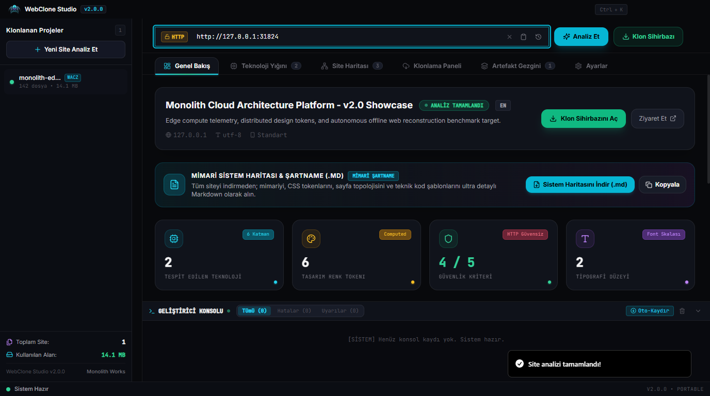
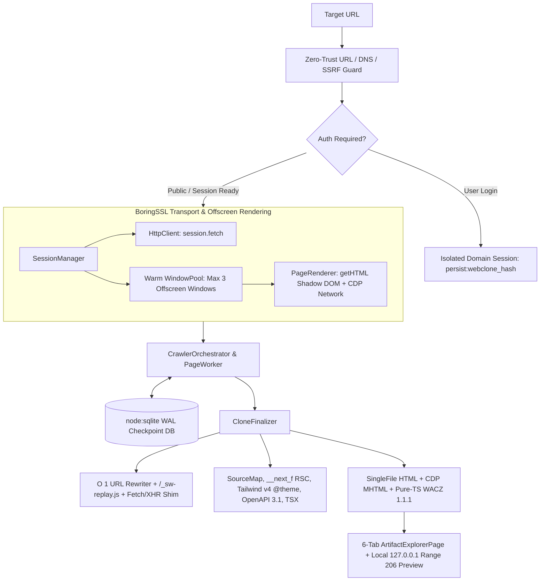
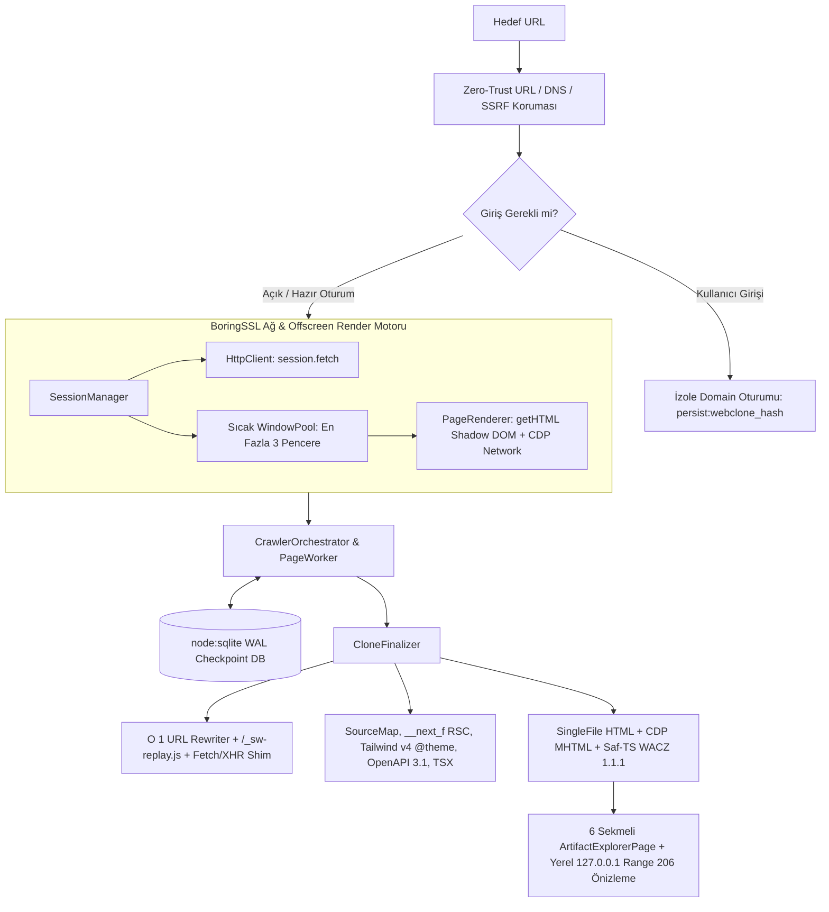

# WebClone Studio

<div align="center">


<br/><br/>

**Autonomous Web Architecture Reconstruction, BoringSSL Offline Mirroring & WACZ 1.1.1 Workstation**

[](https://github.com/MonarchDevLab/WebClone-Studio/actions/workflows/ci.yml)
[](https://github.com/MonarchDevLab/WebClone-Studio/releases/latest)
[](https://github.com/MonarchDevLab/WebClone-Studio/releases)
[](#)
[](#)
[](#)
[](#)
[](#)
[](#)

*Engineered by Monolith Works | Distributed via MonarchDevLab*

<br/>

[ **English Documentation** ](#english-documentation) &nbsp;&bull;&nbsp; [ **Türkçe Dokümantasyon** ](#türkçe-dokümantasyon)

</div>

---

# English Documentation

## Table of Contents
- [Overview](#overview)
- [Architecture Pipeline](#architecture-pipeline)
- [Core v2.0 Capabilities](#core-v20-capabilities)
- [Security & Zero-Trust Boundaries](#security--zero-trust-boundaries)
- [Measured Footprint & Verification](#measured-footprint--verification)
- [Distribution Packages & Installation](#distribution-packages--installation)
- [Developer Commands & CI/CD](#developer-commands--cicd)
- [Ownership & License](#ownership--license)

---

## Overview

**WebClone Studio v2.0.0** is an autonomous desktop workstation built on **Electron 45.3**, **Chromium 156**, and **Node.js 24.22** for software architects, frontend engineers, security analysts, and digital archivists. Instead of saving broken partial HTML dumps like legacy website copiers, WebClone Studio mirrors modern web applications with crash-safe SQLite WAL persistence, reconstructs their frontend engineering artifacts, and packages portable archival outputs.

1. **Unified BoringSSL Transport:** Replaces standalone Node HTTP stacks with Electron's `session.fetch` (`HttpClient`) inside domain-isolated `SessionManager` partitions, matching browser TLS/JA4 fingerprints and cookie vaults without native C++ (`node-gyp`) addons.
2. **Crash-Safe SQLite WAL Checkpointing & Incremental Diff:** Stores active crawl queues, downloaded asset hashes, and mock API captures inside Node's built-in `node:sqlite` (`DatabaseSync` WAL), enabling instant resume after interruptions and HTTP `ETag` / SHA-256 incremental change detection.
3. **Offline Fidelity Replay:** Preserves canonical `/_next/image`, `/_ipx`, and `/cdn-cgi/image` query-variant images with MIME extensions, maintains relative ESM chunk paths, serves `/_sw-replay.js` Service Worker interception, streams media via RFC 9110 HTTP `206 Partial Content`, and injects a dual `fetch`/`XMLHttpRequest` mock shim.
4. **Full Reverse Engineering Lab & 6-Tab Explorer:** Reconstructs SourceMap trees asynchronously, captures Next.js App Router RSC Flight payloads (`self.__next_f`), emits CSS Color 4 (`oklch`/`oklab`/`display-p3`) & Tailwind v4 `@theme` tokens, generates OpenAPI 3.1 / TypeScript contracts, exports multi-landmark React 19 TSX components, and builds pure-TypeScript **WACZ 1.1.1** (`_exports/*.wacz`) archives.
5. **Accessible Desktop Shell:** Code-split React 19 UI (`67.3 KB` initial entry bundle) with WAI-ARIA keyboard tablist navigation, focus-trapped dialogs, `100 ms` coalesced telemetry batching, and zero external runtime requirements.

<br/>

<p align="center">
  
</p>

---

## Architecture Pipeline



---

## Core v2.0 Capabilities

### 1. BoringSSL Session Transport & Warm Chromium Pool
- **Domain-Isolated Cookie Partitions (`SessionManager`):** Assigns deterministic `persist:webclone_<sha256>` partitions per root domain, denying background permissions by default while allowing optional explicit user sign-in inside a guarded visible `BrowserWindow`.
- **Single TLS Stack (`HttpClient`):** Routes static HTML, CSS, JS, and media downloads through Electron `session.fetch` so cookies, headers, HTTP/2 multiplexing, and BoringSSL JA4 signatures stay identical across offscreen renders and bulk downloads.
- **Warm `WindowPool` & `PageRenderer`:** Reuses bounded hidden offscreen Chromium windows (`offscreen: true, sandbox: true`), captures full Declarative Shadow DOM via `getHTML({ serializableShadowRoots: true })`, records complete CDP XHR/Fetch request and response bodies on `Network.loadingFinished`, and enforces wall-clock compositor timeouts.

### 2. SQLite WAL Checkpointing & Incremental Diff
- **Built-in `node:sqlite` (`CrawlCheckpointDb`):** Persists `crawl_runs`, `url_queue`, `assets`, `api_mocks`, and `crawl_diffs` without native addon compilation (`better-sqlite3` / `node-gyp` free).
- **Crash Recovery:** Incomplete runs surface directly in the project list and **Artifact Explorer**, resuming unvisited URLs and existing `url_queue` state cleanly.
- **Incremental `ETag` & SHA-256 Diff:** Re-validates cloned URLs with conditional `If-None-Match` (`304 Not Modified`) and SHA-256 payload hashing to classify pages as `ADDED`, `MODIFIED`, `REMOVED`, or `unchanged`.

### 3. Fidelity URL Mapping, Service Worker Replay & WACZ 1.1.1
- **Query/MIME Proxy Preservation:** Distinguishes image optimization endpoints (`/_next/image`, `/_ipx`, `/cdn-cgi/image`) via canonical sorted query hashing and appends true MIME extensions (`.webp`, `.avif`, `.png`) at download time.
- **Relative ESM Protection:** Preserves same-origin JavaScript directory subpaths under `site/assets/js/` so relative dynamic imports remain resolvable offline.
- **Service Worker & Range Streaming (`PreviewServer`):** Serves `/_sw-replay.js` with `Service-Worker-Allowed: /` resolving dynamic fetches against `_meta/url-map.json` and `_meta/api-endpoints.json`, alongside RFC 9110 HTTP `206 Partial Content` / `416` byte-range video/audio streaming.
- **Pure-TypeScript WACZ 1.1.1 Exporter (`WaczExporter`):** Compresses each captured WARC/1.1 record independently with RFC 1952 `zlib.gzipSync`, generates lexicographically sorted SURT `indexes/index.cdxj`, builds `pages/pages.jsonl`, `datapackage.json`, SHA-256 `datapackage-digest.json`, and packs an uncompressed STORE ZIP archive (`_exports/<slug>.wacz`).

### 4. Upgraded Analyzers & Code Generators
- **Network-Free Duplicate Guard (`TechDetector`):** Avoids redundant fallback HTTP requests when rendered HTML/headers are already provided (`skipNetworkFallback`), adds App Router `__next_f` signals, and removes noisy generic CSS class false positives.
- **Nested XML Sitemaps (`SiteMapper`):** Recursively resolves `<sitemapindex>` `.xml` children up to bounded limits and emits a hierarchical URL path tree.
- **CSS Color 4 & Luminance-Aware Tokens (`DesignAnalyzer` & `TokenExtractor`):** Extracts `#hex`, `oklch()`, `oklab()`, and `color(display-p3 ...)`, prevents background/foreground polarity inversion on light themes, and generates Tailwind v3 JS plus Tailwind v4 `@theme` (`_meta/tokens.theme.css`).
- **Multi-Landmark React TSX & RSC State (`ComponentExporter` & `FrameworkExtractor`):** Converts multiple top-level landmarks (`<header>`, `<main>`, `<section>`, `<footer>`) inside TSX Fragments with parenthesis-aware `data:image/svg+xml` inline style parsing, extracts `self.__next_f.push` Flight chunks, and asynchronously writes reconstructed sourcemaps (`_up_/` for parent paths).

### 5. 6-Tab Artifact Explorer & Accessible Workstation
- **`ArtifactExplorerPage`:** Inspects any completed or resumable project across six keyboard-accessible sub-tabs:
  1. **Preview (`Önizleme`):** Local Preview Server controls, standalone HTML/MHTML/SYSTEM_MAP indicators, and one-click SQLite WAL resume.
  2. **API & Mock (`API & Mock`):** Browse `_meta/openapi.json`, `_meta/api-types.d.ts`, and `_meta/api-endpoints.json`.
  3. **Components (`Bileşenler`):** Inspect generated `_components/*.tsx` files.
  4. **Source Code (`Kaynak Kod`):** Traverse recovered `site/_source-code/` trees.
  5. **Tokens & Data (`Tokenlar & Veri`):** Inspect `tokens.theme.css`, `tailwind.config.js`, `design-tokens.json`, `extracted-state.json`, and `adaptive-entities.json`.
  6. **Archive & Diff (`Arşiv & Fark`):** Generate `WACZ 1.1.1` archives with SHA-256 checksums and run live incremental ETag/SHA-256 diffs.

---

## Security & Zero-Trust Boundaries

| Layer | Enforcement Mechanism | Module |
|---|---|---|
| **SSRF & DNS Rebinding Guard** | Blocks loopback, RFC 1918 private networks, IPv6 ULA/mapped IPv4, link-local (`169.254.0.0/16`), and cross-host `302` redirects; localhost allowed only by explicit user toggle | [`url-guard.ts`](src/main/security/url-guard.ts) |
| **Filesystem Containment** | Canonical `fs.realpath` containment checks (`assertInsideRoot`) for `PreviewServer`, `SingleFileExporter`, `WaczExporter`, and artifact reads; safe deletion locks (`manifest.json` + non-root guard) | [`path-guard.ts`](src/main/security/path-guard.ts) |
| **Preload Least Privilege & CSP** | Strict renderer CSP (`script-src 'self'; object-src 'none'`); removes raw `send`/`invoke`/`on`/`removeListener`; validates IPC sender frame origin | [`preload/index.ts`](src/preload/index.ts), [`ipc-guard.ts`](src/main/security/ipc-guard.ts) |
| **Window & TLS Isolation** | Enforces `sandbox: true, contextIsolation: true, nodeIntegration: false`; blocks untrusted `will-navigate` / popups; TLS relaxation requires explicit per-clone opt-in (`ignoreSslErrors`) | [`window.ts`](src/main/window.ts), [`session-manager.ts`](src/main/browser/session-manager.ts) |
| **User-Driven Auth** | Never uses third-party anti-bot/CAPTCHA solving APIs; interactive login runs solely in a user-controlled Chromium window | [`page-renderer.ts`](src/main/browser/page-renderer.ts) |

---

## Measured Footprint & Verification

All metrics below are directly measured on the v2.0.0 build (`Electron 45.3.2`, `Chromium 156`, `Node 24.22.2`):

| Artifact / Suite | v1.1.0 Baseline | v2.0.0 Measured | Notes |
|---|---|---|---|
| **Main Bundle (`out/main/index.js`)** | `1,385 KB` | `332.14 KB` | `-76.0%` after `got` removal and `cheerio/slim` |
| **Preload Bundle (`out/preload/index.js`)** | `~9 KB` | `5.79 KB` | Least-privilege bridge surface |
| **Renderer Entry JS (`out/renderer/assets/index-*.js`)** | `1,082 KB` | `67.27 KB` | `-93.8%` via `React.lazy` + `manualChunks` (`< 450 KB` target) |
| **TitleBar Logo (`logo-64.png`)** | `1,052 KB` | `6.93 KB` | `< 10 KB` transparent 64x64 PNG |
| **App Package (`resources/app.asar`)** | `9.50 MB` | `2.24 MB` | `-76.4%` with zero duplicate runtime dependencies |
| **Vitest Suite (`npm test`)** | `26 tests` | `24 files, 66 tests` | Security, SQLite WAL, SW/Range, WACZ, Analyzers, Integration, RTL UI |
| **Playwright E2E (`npm run test:e2e`)** | `N/A` | `2/2 specs` | Real Electron 45 launch, Preload audit, A11y keyboard, Clone + WACZ + Explorer |

---

## Distribution Packages & Installation

Windows x64 installers built from v2.0.0:

```text
dist/
├── WebClone-Studio-Portable.exe       # Standalone zero-install binary (98.51 MB, app.asar 2.24 MB)
├── WebClone-Studio-Setup-2.0.0.exe    # NSIS interactive installer with shortcuts (108.52 MB)
└── WebClone-Studio-2.0.0.msi          # Windows Installer package for enterprise rollout (113.18 MB)
```

- **Portable Edition:** Run `WebClone-Studio-Portable.exe` directly from any folder or removable drive without installation. Note: the `~98.5 MB` size reflects Chromium 156's upstream runtime (`dxcompiler.dll` `24.6 MB` + `Electron 45` binary), while the bundled application archive (`app.asar`) is `2.24 MB`.
- **Setup Installer (`.exe`) & MSI (`.msi`):** Standard per-user or enterprise Windows installation packages.
- **macOS & Linux:** Configured in [`electron-builder.yml`](electron-builder.yml) and [`.github/workflows/release.yml`](.github/workflows/release.yml) for `dmg` (x64/arm64) and `AppImage` (x64).

---

## Developer Commands & CI/CD

```bash
# Install dependencies (Node 24 recommended)
npm install

# Run development desktop app
npm run dev

# TypeScript verification
npm run typecheck

# Run unit, UI, and local HTTP integration tests
npm test

# Build production bundles (main, preload, renderer)
npm run build

# Run Playwright Electron E2E tests against built out/main/index.js
npm run test:e2e

# Package Windows installers
npm run build:portable   # Portable .exe only
npm run build:setup      # NSIS Setup .exe only
npm run build:msi        # Enterprise .msi only
npm run build:all        # Setup + Portable + MSI
```

- **CI Pipeline ([`.github/workflows/ci.yml`](.github/workflows/ci.yml)):** Runs `typecheck`, zero-leakage scan, Vitest suite, `electron-vite build`, and Playwright Electron E2E across `windows-latest` and `ubuntu-latest` (`xvfb-run`).
- **Release Pipeline ([`.github/workflows/release.yml`](.github/workflows/release.yml)):** On `v*.*.*` tags, builds Windows (`nsis`, `portable`, `msi`), macOS (`dmg`), and Linux (`AppImage`) installers and generates `SHA256SUMS.txt`.

---

## Ownership & License

Authored and owned by **Monolith Works**. Official GitHub publication channel: **MonarchDevLab**.  
Licensed under the **MIT License**. Third-party open-source components retain their respective licenses (`LICENSES.chromium.html`).

---

<br/>

# Türkçe Dokümantasyon

## İçindekiler
- [Genel Bakış](#genel-bakış)
- [Mimari Akış Şeması](#mimari-akış-şeması)
- [v2.0 Temel Yetenekler](#v20-temel-yetenekler)
- [Güvenlik ve Zero-Trust Sınırları](#güvenlik-ve-zero-trust-sınırları)
- [Ölçülen Boyut ve Doğrulama Sonuçları](#ölçülen-boyut-ve-doğrulama-sonuçları)
- [Kurulum Paketleri ve Dağıtım](#kurulum-paketleri-ve-dağıtım)
- [Geliştirici Komutları ve CI/CD](#geliştirici-komutları-ve-cicd)
- [Mülkiyet ve Lisans](#mülkiyet-ve-lisans)

---

## Genel Bakış

**WebClone Studio v2.0.0**, yazılım mimarları, frontend mühendisleri, güvenlik analistleri ve dijital arşivciler için **Electron 45.3**, **Chromium 156** ve **Node.js 24.22** üzerine kurulmuş otonom bir masaüstü çalışma istasyonudur. Yalnızca kırık HTML dosyaları indiren klasik araçların aksine, karmaşık web uygulamalarını çökme dayanıklı SQLite WAL kontrol noktalarıyla yansılar, tersine mühendislik çıktılarını derler ve taşınabilir arşivler üretir.

1. **Tekilleştirilmiş BoringSSL Ağ Katmanı:** Harici `got` istemcisi yerine domain başına izole edilmiş `SessionManager` oturumları içinde Electron `session.fetch` (`HttpClient`) kullanılır; sıfır C++ (`node-gyp`) eklentisi ile tarayıcı düzeyinde TLS JA4 ve çerez tutarlılığı sağlanır.
2. **Çökme Dayanıklı SQLite WAL & Artımlı Fark Denetimi:** Klonlama kuyruğu, dosya karmaları ve API mock kayıtları Node yerleşik `node:sqlite` (`DatabaseSync` WAL) veritabanında saklanır; yarıda kalan işlemler kaldığı yerden sürdürülür ve `ETag` / `If-None-Match` + SHA-256 ile sayfa değişiklikleri ölçülür.
3. **Yüksek Çevrimdışı Sadakat:** `/_next/image`, `/_ipx` ve `/cdn-cgi/image` proxy görsellerini kanonik sorgu karmasıyla ayırır ve MIME uzantısı ekler; göreli ESM modül yollarını korur; `/_sw-replay.js` Service Worker, HTTP `206 Partial Content` Range medya akışı ve çift yönlü `fetch`/`XMLHttpRequest` shim enjekte eder.
4. **Tersine Mühendislik Laboratuvarı ve 6 Sekmeli Gezgin:** SourceMap kod ağacını asenkron kurtarır (`_up_/` korumasıyla), Next.js RSC (`self.__next_f`) durumlarını ayıklar, CSS Color 4 (`oklch`/`oklab`/`display-p3`) ve Tailwind v4 `@theme` tokenları (`_meta/tokens.theme.css`) üretir, OpenAPI 3.1 / TypeScript sözleşmeleri, çok bölümlü React TSX bileşenleri ve saf TypeScript **WACZ 1.1.1** (`.wacz`) arşivleri oluşturur.
5. **Erişilebilir Masaüstü Arayüzü:** `React.lazy` + `manualChunks` ile bölünmüş arayüz (`67.3 KB` giriş JS paketi), WAI-ARIA ok tuşlu sekme gezinmesi, odak tuzaklı modallar (`useFocusTrap`) ve `100 ms` toplu IPC telemetri sunar.

---

## Mimari Akış Şeması



---

## v2.0 Temel Yetenekler

### 1. BoringSSL Ağ İletimi ve Sıcak Chromium Havuzu
- **Domain İzolasyonlu Oturumlar (`SessionManager`):** Her kök domain için ayrı `persist:webclone_<sha256>` oturumu oluşturur; arka plan izinlerini kapatır, korumalı panellerde yalnız kullanıcının yönettiği görünür oturum penceresi üzerinden çerez devri sağlar.
- **Tek TLS Motoru (`HttpClient`):** Statik HTML, CSS, JS ve medya indirmelerini `session.fetch` üzerinden geçirerek render ve indirme arasındaki TLS/çerez uyuşmazlığını ortadan kaldırır.
- **Sıcak `WindowPool` ve `PageRenderer`:** Gizli offscreen Chromium pencerelerini yeniden kullanır; `getHTML({ serializableShadowRoots: true })` ile Shadow DOM ağaçlarını serileştirir, CDP `Network.loadingFinished` ile tam API yanıt gövdelerini yakalar ve compositor zaman aşımı koruması uygular.

### 2. SQLite WAL Checkpointing ve Artımlı Fark Analizi
- **Yerleşik `node:sqlite` (`CrawlCheckpointDb`):** `node-gyp` veya C++ derlemesi gerektirmeden `crawl_runs`, `url_queue`, `assets`, `api_mocks` ve `crawl_diffs` tablolarını yönetir.
- **Kesintisiz Devam Etme:** Yarıda kalan projeler doğrudan yan menüde ve **Artefakt Gezgini** içinde listelenerek kaldığı noktadan devam ettirilir.
- **ETag / SHA-256 Karşılaştırma:** Önceden klonlanan URL'leri `If-None-Match` (`304`) ve içerik karmasıyla denetleyip `ADDED`, `MODIFIED`, `REMOVED` ve `unchanged` raporu çıkarır.

### 3. Çevrimdışı Sadakat, Service Worker Replay ve WACZ 1.1.1
- **Sorgu ve MIME Odaklı Varlık Haritalama:** `/_next/image`, `/_ipx`, `/cdn-cgi/image` yollarındaki farklı sorguları sıralı kanonik karma ile ayırır; indirme sırasında gerçek içerik türüne göre uzantı (`.webp`, `.avif`, `.png`) ekler.
- **Göreli ESM Modül Koruması:** Aynı origin altındaki JavaScript dosyalarının alt klasör hiyerarşisini `site/assets/js/` içinde koruyarak göreli modül çağrılarını çalışır tutar.
- **Service Worker & Range Streaming (`PreviewServer`):** `/_sw-replay.js` (`Service-Worker-Allowed: /`) ile çalışma zamanı isteklerini `_meta/url-map.json` ve mock veritabanından çözer; medya dosyalarını RFC 9110 `206 Partial Content` / `416` bayt aralığıyla aktarır.
- **Saf TypeScript WACZ 1.1.1 (`WaczExporter`):** Her WARC/1.1 kaydını bağımsız `zlib.gzipSync` üyeleriyle paketler, SURT sıralı `indexes/index.cdxj`, `pages/pages.jsonl`, `datapackage.json` ve SHA-256 `datapackage-digest.json` dosyalarını STORE ZIP biçiminde `_exports/<slug>.wacz` olarak kaydeder.

### 4. Analizörler, Üreticiler ve 6 Sekmeli Artefakt Gezgini
- `TechDetector` `skipNetworkFallback` ile mükerrer ağ isteğini önler; `SiteMapper` iç içe `<sitemapindex>` `.xml` haritalarını hiyerarşik ağaca dönüştürür.
- `DesignAnalyzer` ve `TokenExtractor`, `oklch()`, `oklab()` ve `color(display-p3 ...)` renklerini çıkarır, luminans duyarlı arka plan/ön plan rolü atar ve `_meta/tokens.theme.css` (Tailwind v4 `@theme`) üretir.
- `ComponentExporter`, `header`/`main`/`section`/`footer` bölgelerini çoklu React TSX bileşenine dönüştürür ve `url(data:image/svg+xml;base64,...)` stillerini bozmadan işler.
- `ArtifactExplorerPage` içindeki 6 sekme (`Önizleme`, `API & Mock`, `Bileşenler`, `Kaynak Kod`, `Tokenlar & Veri`, `Arşiv & Fark`) üzerinden tüm çıktılar anlık olarak incelenir ve dışa aktarılır.

---

## Güvenlik ve Zero-Trust Sınırları

| Katman | Koruma Mekanizması | Modül |
|---|---|---|
| **SSRF ve Yönlendirme Koruması** | Loopback, özel RFC 1918 ağlar, IPv6 yerel adresleri, bulut metadata (`169.254.0.0/16`) ve `302` domain dışı yönlendirmeleri engeller | [`url-guard.ts`](src/main/security/url-guard.ts) |
| **Dosya Sistemi Koruması** | `fs.realpath` tabanlı kök doğrulama (`assertInsideRoot`), güvenli klasör silme kilidi (`manifest.json` doğrulaması) | [`path-guard.ts`](src/main/security/path-guard.ts) |
| **En Az Yetki Preload ve CSP** | Katı CSP başlığı; ham `send`/`invoke`/`on`/`removeListener` erişiminin kaldırılması; gönderici origin denetimi | [`preload/index.ts`](src/preload/index.ts), [`ipc-guard.ts`](src/main/security/ipc-guard.ts) |
| **Pencere ve TLS Politikası** | `sandbox: true, contextIsolation: true, nodeIntegration: false`; yetkisiz gezinme engeli; sertifika esnetme için açık kullanıcı onayı | [`window.ts`](src/main/window.ts), [`session-manager.ts`](src/main/browser/session-manager.ts) |
| **Kullanıcı Kontrollü Oturum** | Harici CAPTCHA/anti-bot çözümleyici kullanmaz; giriş yalnız kullanıcının açtığı etkileşimli tarayıcı penceresinde yapılır | [`page-renderer.ts`](src/main/browser/page-renderer.ts) |

---

## Ölçülen Boyut ve Doğrulama Sonuçları

| Bileşen / Test Paketi | v1.1.0 | v2.0.0 Ölçümü | Açıklama |
|---|---|---|---|
| **Ana Süreç Paketi (`out/main/index.js`)** | `1,385 KB` | `332.14 KB` | `-%76.0` (`got` kaldırımı + `cheerio/slim`) |
| **Preload Paketi (`out/preload/index.js`)** | `~9 KB` | `5.79 KB` | En az yetki yüzeyli köprü |
| **Renderer Giriş JS (`out/renderer/assets/index-*.js`)** | `1,082 KB` | `67.27 KB` | `-%93.8` (`React.lazy` + `manualChunks`) |
| **Başlık Çubuğu Logosu (`logo-64.png`)** | `1,052 KB` | `6.93 KB` | `< 10 KB` şeffaf 64x64 PNG |
| **Uygulama Paketi (`resources/app.asar`)** | `9.50 MB` | `2.24 MB` | `-%76.4` bağımlılık sadeleştirmesi |
| **Vitest Paketi (`npm test`)** | `26 test` | `24 dosya, 66 test` | Güvenlik, SQLite WAL, SW/Range, WACZ, Analizör, Entegrasyon, RTL |
| **Playwright E2E (`npm run test:e2e`)** | `Yok` | `2/2 senaryo` | Gerçek Electron 45 süreci, Preload, Klavye A11y, Klon + WACZ + Gezgin |

---

## Kurulum Paketleri ve Dağıtım

Windows x64 için üretilen v2.0.0 paketleri:

```text
dist/
├── WebClone-Studio-Portable.exe       # Kurulum gerektirmeyen taşınabilir sürüm (98.51 MB, app.asar 2.24 MB)
├── WebClone-Studio-Setup-2.0.0.exe    # Kısayollar ve kaldırıcı içeren NSIS kurulum paketi (108.52 MB)
└── WebClone-Studio-2.0.0.msi          # Kurumsal ağ dağıtımı için Windows Installer paketi (113.18 MB)
```

- **Portable Sürüm:** Herhangi bir klasörden veya USB sürücüden doğrudan çalıştırılır. Toplam `~98.5 MB` boyut Chromium 156 çekirdeğinden (`dxcompiler.dll` `24.6 MB` + `Electron 45` ikilisi) kaynaklanır; uygulama paketi (`app.asar`) `2.24 MB`'tır.
- **Setup (`.exe`) ve MSI (`.msi`):** Masaüstü/başlat menüsü kısayolları ve GPO/Intune kurumsal dağıtım için uygundur.
- **macOS ve Linux:** [`electron-builder.yml`](electron-builder.yml) ve [`.github/workflows/release.yml`](.github/workflows/release.yml) üzerinde `dmg` (x64/arm64) ve `AppImage` (x64) hedefleri yapılandırılmıştır.

---

## Geliştirici Komutları ve CI/CD

```bash
# Bağımlılıkları kurun (Node 24 önerilir)
npm install

# Geliştirici modunda çalıştırın
npm run dev

# TypeScript tip denetimi
npm run typecheck

# Birim, UI ve entegrasyon testlerini çalıştırın
npm test

# Üretim paketlerini derleyin
npm run build

# Gerçek Electron 45 üzerinde Playwright E2E testlerini koşun
npm run test:e2e

# Windows çalıştırılabilir paketlerini oluşturun
npm run build:portable   # Sadece Portable .exe
npm run build:setup      # Sadece NSIS Setup .exe
npm run build:msi        # Sadece Kurumsal .msi
npm run build:all        # Setup + Portable + MSI
```

---

## Mülkiyet ve Lisans

Bu yazılımın tüm hakları **Monolith Works** kuruluşuna aittir. Resmi GitHub yayın kanalı: **MonarchDevLab**.  
Lisans: **MIT License**. Üçüncü taraf bileşenler kendi lisans haklarını (`LICENSES.chromium.html`) korur.
