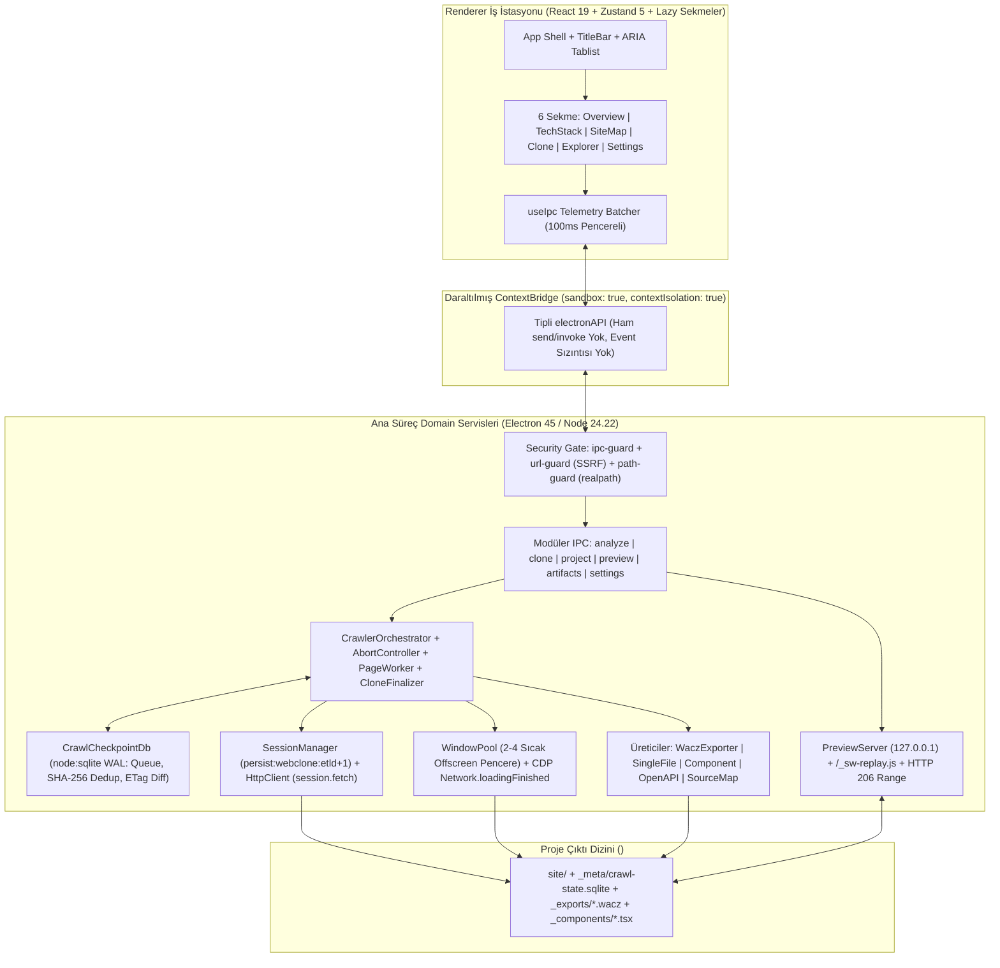
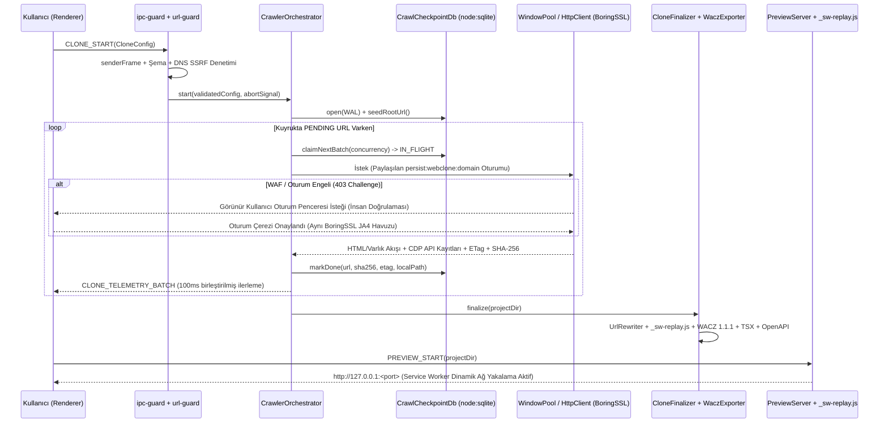
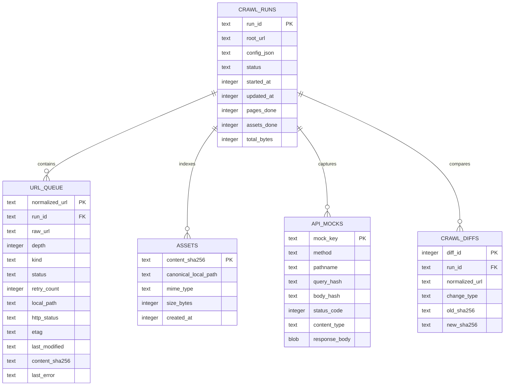
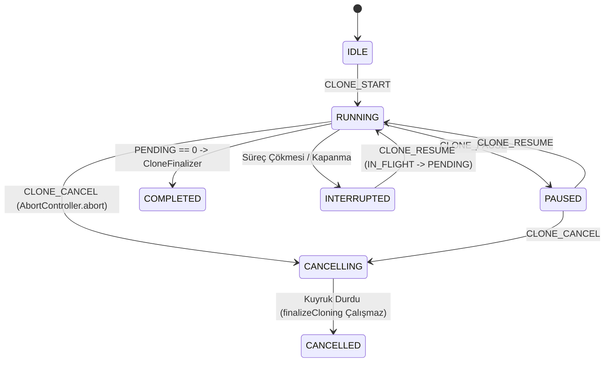
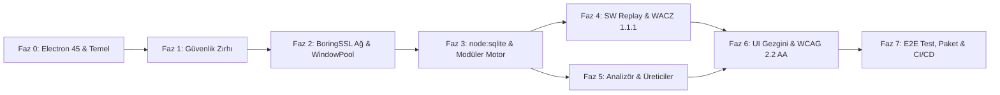

# WebClone Studio v2.0 - Ultra Detaylı Mimari ve Geliştirme Master Planı

- **Belge Kimliği:** `MW-PLAN-2026-WEBCLONE-V2`
- **Mülkiyet ve Yayın Kanalı:** Monolith Works (Yayın: MonarchDevLab)
- **Mevcut Sürüm Tabanı:** `v1.1.0` (Electron `33.4.0`, React `19.2.4`, TypeScript `5.9.3`, Tailwind CSS `4.2.1`, Zustand `5.0.11`)
- **Hedef Sürüm:** `v2.0.0` (Electron `45.x`, Chromium `156`, Node.js `24.22 LTS`)
- **Risk Sınıfı:** `REVIEW` (Mimari yükseltme, güvenlik sertleştirme, çoklu modül ayrıştırması, yeni IPC ve SQLite veri şeması)
- **Kapsam Kısıtı:** Sıfır harici C++ (`node-gyp`) eklentisi; taşınabilir `.exe` boyutu `<= 80 MB`; insan doğrulama/CAPTCHA kapılarında üçüncü taraf bot/çözücü entegrasyonu kesinlikle yoktur (yalnız görünür kullanıcı oturum penceresi).

---

## 1. Yönetici Özeti ve Ölçülmüş Mevcut Durum Tabanı

WebClone Studio v1.1.0; statik HTML/CSS varlık tarama, offscreen Chromium CDP render, MHTML/SingleFile çıktı üretimi ve temel tersine mühendislik yeteneklerini tek bir masaüstü paketinde sunmaktadır. Ancak kod tabanındaki 68 dosyanın tamamı üzerinde yapılan satır bazlı denetim ve canlı derleme ölçümleri, ürünün kurumsal ölçekte güvenilirlik, güvenlik ve %100 çevrimdışı klonlama sadakati için 6 yapısal darboğaza takıldığını kanıtlamıştır:

1. **Çalışma Zamanı Eskimesi ve TLS JA4 Ayrışması:** Uygulama EOL durumundaki Electron `33.4.0` ([`package.json`](file:///e:/Personel/Branding/Uygulama/Web-clone/package.json#L39)) üzerinde çalışmakta; dinamik sayfa render katmanı Chromium BoringSSL kullanırken statik indirme katmanı ([`asset-downloader.ts`](file:///e:/Personel/Branding/Uygulama/Web-clone/src/main/cloner/asset-downloader.ts#L134-L286)) ve güvenlik tarayıcısı ([`security-scanner.ts`](file:///e:/Personel/Branding/Uygulama/Web-clone/src/main/analyzers/security-scanner.ts#L22-L62)) Node.js `got` (OpenSSL) kullanmaktadır. Cloudflare ve modern WAF katmanları `cf_clearance` çerezini TLS JA4 parmak izi ve HTTP/2 çerçeve düzenine bağladığından, `PageRenderer` ile geçilen oturum alt varlık indirmelerinde 403 hatasına düşebilmektedir.
2. **Kritik Masaüstü Güvenlik Açıkları:** Ana pencerede `will-navigate` ve `setWindowOpenHandler` eksikliği ([`window.ts`](file:///e:/Personel/Branding/Uygulama/Web-clone/src/main/window.ts#L11-L30)), [`index.html`](file:///e:/Personel/Branding/Uygulama/Web-clone/src/renderer/index.html#L1-L12) içinde CSP bulunmaması, [`singlefile-exporter.ts`](file:///e:/Personel/Branding/Uygulama/Web-clone/src/main/generators/singlefile-exporter.ts#L19-L86) içinde dizin dışına taşan yerel dosya okuma (Path Traversal), [`project-store.ts`](file:///e:/Personel/Branding/Uygulama/Web-clone/src/main/storage/project-store.ts#L89-L99) içinde kök çıktı klasörünü silebilen sınır hatası, [`ipc-handlers.ts`](file:///e:/Personel/Branding/Uygulama/Web-clone/src/main/ipc-handlers.ts#L335-L342) içinde kısıtsız `shell.openPath` çalıştırma yüzeyi ve [`preview-server.ts`](file:///e:/Personel/Branding/Uygulama/Web-clone/src/main/server/preview-server.ts#L83-L165) içinde yansıtılan (reflected) XSS açıkları mevcuttur.
3. **Çökme Dayanımı Eksikliği ve Monolitik Modüller:** Tarama kuyruğu yalnız RAM üzerinde tutulmakta; uygulama kapandığında veya hedef site bağlantıyı kestiğinde binlerce sayfalık ilerleme sıfırlanmaktadır. [`crawler-engine.ts`](file:///e:/Personel/Branding/Uygulama/Web-clone/src/main/cloner/crawler-engine.ts#L94-L1125) (1125 satır), [`page-renderer.ts`](file:///e:/Personel/Branding/Uygulama/Web-clone/src/main/browser/page-renderer.ts#L65-L686) (686 satır), [`CloneSetupModal.tsx`](file:///e:/Personel/Branding/Uygulama/Web-clone/src/renderer/src/components/modal/CloneSetupModal.tsx#L1-L799) (799 satır) ve [`OverviewPage.tsx`](file:///e:/Personel/Branding/Uygulama/Web-clone/src/renderer/src/pages/OverviewPage.tsx#L1-L508) (508 satır) tek sorumluluk sınırını aşmıştır.
4. **Klonlama Sadakati Kırılmaları:** Chromium 128+ ile kaldırılan `getInnerHTML({ includeShadowRoots: true })` çağrısı ([`page-renderer.ts`](file:///e:/Personel/Branding/Uygulama/Web-clone/src/main/browser/page-renderer.ts#L449-L470)) her sayfada sessizce `TypeError` fırlatarak Shadow DOM ve `<!DOCTYPE html>` bilgisini düşürmekte; `/_next/image?url=...&w=...` sorgulu görseller ilk indirilen görsele ezilmekte ([`url-rewriter.ts`](file:///e:/Personel/Branding/Uygulama/Web-clone/src/main/cloner/url-rewriter.ts#L30-L32)); çevrimdışı shim `XMLHttpRequest`/Axios ve dinamik ESM `import()` çağrılarını kaçırmaktadır.
5. **Arka Uç Çıktılarının %80'inin Arayüzde Görünmez Olması:** Arka uçta üretilen `_meta/openapi.json`, `_meta/api-types.d.ts`, `_meta/adaptive-entities.json`, `_meta/extracted-state.json`, `_components/*.tsx` ve `site/_source-code/` çıktılarının hiçbirini uygulama içinden gösteren bir inceleyici yoktur; [`Sidebar.tsx`](file:///e:/Personel/Branding/Uygulama/Web-clone/src/renderer/src/components/Sidebar.tsx#L105) üzerindeki proje tıklaması işlevsizdir.
6. **Test ve CI/CD Boşluğu:** 68 dosyalık depoda yalnız 8 birim test dosyası (28 vaka) bulunmakta; ana tarama motoru, önizleme sunucusu, depolama katmanı, preload köprüsü ve 23 React bileşeninin tamamında 0 test ve 0 GitHub Actions iş akışı mevcuttur.

### 1.1 Canlı Ölçülmüş Performans ve Boyut Tabanı (Baseline vs Hedef)

| Ölçüm Kalemi | Mevcut Ölçüm (v1.1.0) | v2.0 Hedef Bütçesi | Mühendislik Müdahalesi |
|---|---|---|---|
| Çalışma Zamanı | Electron `33.4.0` (EOL, Node 20, Cr 130) | Electron `45.x` (Node 24.22, Cr 156) | Yerleşik `node:sqlite` + güncel BoringSSL JA4 |
| `out/main/index.js` | `1,418,513 bayt` (`1,385.3 KB`) | `< 650 KB` | `got` paketinin kaldırılması, `session.fetch` geçişi |
| `out/preload/index.js` | `6,458 bayt` (`6.3 KB`) | `< 8 KB` | Daraltılmış, tipli `contextBridge` yüzeyi |
| `out/renderer/assets/index-*.js` | `1,108,425 bayt` (`1,082.4 KB` tek yığın) | `< 450 KB` başlangıç yığını | `React.lazy` ile 6 sekme bazlı kod bölme |
| `src/renderer/src/assets/logo.png` | `1,052,244 bayt` (`1,027.6 KB`, 1024x1024) | `< 10 KB` (`64x64` WebP/PNG) | `TitleBar` (`24x24` px) için boyutlandırılmış varlık |
| Taşınabilir Paket (`Portable.exe`) | `76.9 MB` (`app.asar` `9.5 MB`) | `<= 80.0 MB` (`app.asar` `< 7.5 MB`) | Çift `node_modules` kopyası temizliği + 0 C++ eklenti |
| `electron-vite build` Süresi | `8,726 ms` | `< 7,000 ms` | `got` ağaç-sallama (tree-shaking) yükünün kalkması |
| Test Paketi Kapsamı | 8 dosya / 28 test (`922 ms`) | 28+ dosya / 180+ test (`>= %85` çekirdek) | Birim + yerel HTTP fixture entegrasyon + Playwright E2E |

### 1.2 Stratejik Mimari Kararlar (Ponytail P3.0 Kıyaslaması)

| Problem Alanı | Seçilen Ponytail Çözümü (v2.0) | Reddedilen Alternatif | Reddetme Gerekçesi |
|---|---|---|---|
| Statik HTTP ve Varlık İndirme | Electron `session.fromPartition(...).fetch` | `got` / `undici` / `curl-impersonate` | `session.fetch` Chromium BoringSSL JA4 izini, HTTP/2 havuzunu ve çerez kavanozunu sıfır ek boyutla `PageRenderer` ile birebir paylaşır. |
| Tarama Durumu ve Kaldığı Yerden Devam | Node 24 yerleşik `node:sqlite` (`DatabaseSync` WAL) | `better-sqlite3` / `prisma` / `leveldown` | Harici C++ derlemesi (`node-gyp`) Electron ABI geçişlerinde kırılır ve boyutu büyütür; `node:sqlite` Node 24 içinde sıfır bayt ek yükle yerleşiktir. |
| Dinamik SPA Çevrimdışı Oynatma | `PreviewServer` üzerinde `/_sw-replay.js` Service Worker + çift yönlü XHR/Fetch shim | `@babel/parser` / `@swc/core` ile JS AST mutasyonu | Obfuscate edilmiş webpack/vite yığınlarını AST ile değiştirmek kırılgan sözdizimi hataları üretir ve `+20 MB` bağımlılık ekler; Service Worker ağ sınırında kırmadan yakalar. |
| Taşınabilir Dijital Arşiv | Saf TypeScript akış tabanlı **WACZ 1.1.1** (`zlib.createGzip` + ZIP akışı) | Harici Python `warcio` / `webrecorder` CLI | Python çalışma zamanı gömmek taşınabilir paketi `+150 MB` şişirir; Node `node:zlib` + `node:crypto` ile standart WARC 1.1 + CDXJ sıfır bağımlılıkla üretilir. |

---

## 2. Tam Kod Tabanı Denetim Bulguları ve Kök Neden Matrisi

Aşağıdaki 36 bulgu, kod tabanındaki gerçek dosya ve satır numaralarıyla doğrulanmıştır:

### 2.1 Güvenlik ve Süreç İzolasyonu Bulguları (`SEC`)

| Kod | Önem | Konum (`dosya:satır`) | Kök Neden ve Etki | Çözüm Fazı |
|---|---|---|---|---|
| `SEC-01` | KRİTİK | [`singlefile-exporter.ts`](file:///e:/Personel/Branding/Uygulama/Web-clone/src/main/generators/singlefile-exporter.ts#L19-L86) | Eşleşmeyen göreli `href`/`src`/`url()` yolları sınır denetimi olmadan `siteDir` ile birleştirilip okunuyor (`../../...`); üst dizindeki yerel dosyalar üretilen HTML içine gömülebilir. Satır 63'te `$(sc).text(jsContent)` `</script>` dizgisini kaçırmıyor. | Faz 1 |
| `SEC-02` | KRİTİK | [`project-store.ts`](file:///e:/Personel/Branding/Uygulama/Web-clone/src/main/storage/project-store.ts#L89-L99) | `deleteProject` metoduna `defaultOutputDir` verildiğinde `path.relative` boş dizgi `""` döndürüyor, `!relative.startsWith('..')` koşulunu geçip tüm projelerin kök klasörünü siliyor. Ayrıca `manifest.json` üretici imzası doğrulanmıyor. | Faz 1 |
| `SEC-03` | KRİTİK | [`ipc-handlers.ts`](file:///e:/Personel/Branding/Uygulama/Web-clone/src/main/ipc-handlers.ts#L53-L342) | Hiçbir IPC kanalında `event.senderFrame` doğrulaması yok; `SHELL_OPEN_FILE` (satır 335) `shell.openPath` ile `.exe`, `.bat`, `.cmd`, `.ps1` ve UNC ağ yollarını doğrudan çalıştırabiliyor. | Faz 1 |
| `SEC-04` | YÜKSEK | [`window.ts`](file:///e:/Personel/Branding/Uygulama/Web-clone/src/main/window.ts#L11-L30), [`index.html`](file:///e:/Personel/Branding/Uygulama/Web-clone/src/renderer/index.html#L1-L12) | Ana pencerede `will-navigate` ve `setWindowOpenHandler` yok; `index.html` içinde `Content-Security-Policy` tanımlanmamış. Harici link tıklaması `window.electronAPI` yüklü pencerede gezinti riski taşır. | Faz 1 |
| `SEC-05` | YÜKSEK | [`preview-server.ts`](file:///e:/Personel/Branding/Uygulama/Web-clone/src/main/server/preview-server.ts#L71-L165), [`crawler-engine.ts`](file:///e:/Personel/Branding/Uygulama/Web-clone/src/main/cloner/crawler-engine.ts#L805) | `decodeURIComponent(pathname)` 404 yanıtına ve `item.url` `_404.html` dosyasına kaçışsız gömülüyor (Reflected + Stored XSS). Sembolik bağ (`fs.realpath`) kontrolü ve `X-Content-Type-Options: nosniff` eksik; `Access-Control-Allow-Origin: *` tüm yerel sitelere açık. | Faz 1 |
| `SEC-06` | YÜKSEK | [`page-renderer.ts`](file:///e:/Personel/Branding/Uygulama/Web-clone/src/main/browser/page-renderer.ts#L81-L97), [`security-scanner.ts`](file:///e:/Personel/Branding/Uygulama/Web-clone/src/main/analyzers/security-scanner.ts#L22-L62) | Yalnız ilk URL kontrol ediliyor; HTTP `301/302` (`will-redirect`) ile `127.0.0.1`, RFC1918 özel ağlar veya `169.254.169.254` bulut metadatasına yönlendirme (SSRF) açık. `authWin` (satır 649) tüm siteler için tek global `persist:webclone` bölmesini paylaşıyor. | Faz 1-2 |
| `SEC-07` | YÜKSEK | [`asset-downloader.ts`](file:///e:/Personel/Branding/Uygulama/Web-clone/src/main/cloner/asset-downloader.ts#L137-L292) | `https: { rejectUnauthorized: false }` koşulsuz açıkken yakalanan oturum çerezleri (`Cookie`) gönderiliyor; aktif MITM saldırısında oturum çerezleri sızar. | Faz 2 |
| `SEC-08` | ORTA | [`preload/index.ts`](file:///e:/Personel/Branding/Uygulama/Web-clone/src/preload/index.ts#L24-L125) | Genel amaçlı `send`, `invoke`, `on` yardımcıları ve ham `IpcRendererEvent` nesnesi renderer dünyasına sızdırılıyor; `subscriptionMap` kanal adını anahtara dahil etmiyor. | Faz 1 |

### 2.2 Tarayıcı, Ağ ve Klonlama Motoru Bulguları (`NET` & `ENG`)

| Kod | Önem | Konum (`dosya:satır`) | Kök Neden ve Etki | Çözüm Fazı |
|---|---|---|---|---|
| `NET-01` | KRİTİK | [`asset-downloader.ts`](file:///e:/Personel/Branding/Uygulama/Web-clone/src/main/cloner/asset-downloader.ts#L44-L286) | Node `got` (OpenSSL) ile Chromium (BoringSSL) TLS JA4 parmak izi uyuşmazlığı ve sabit kodlu Chrome 131 `sec-ch-ua` başlığı WAF `cf_clearance` reddine yol açıyor. | Faz 2 |
| `NET-02` | YÜKSEK | [`asset-downloader.ts`](file:///e:/Personel/Branding/Uygulama/Web-clone/src/main/cloner/asset-downloader.ts#L132-L162) | Dıştaki `for (attempt = 1..3)` döngüsü `got` iç `retry: { limit: 2 }` ayarıyla çarpılarak ölü URL başına `3 x 3 = 9` istek fırtınası üretiyor; `fileStream.destroy()` sonrası Windows dosya kilidi serbest kalmadan `unlink` çağrılıyor (`EBUSY`). | Faz 2 |
| `NET-03` | YÜKSEK | [`page-renderer.ts`](file:///e:/Personel/Branding/Uygulama/Web-clone/src/main/browser/page-renderer.ts#L134-L160) | `Network.getResponseBody` gövde akışı bitmeden `Network.responseReceived` anında çağrıldığı için parçalı JSON yanıtları düşüyor; HTTP/1.1 isteklerde `:method` sözde başlığı olmadığından POST istekleri `GET` sanılıyor ve `postData` kaydedilmiyor. | Faz 2 |
| `NET-04` | ORTA | [`crawler-engine.ts`](file:///e:/Personel/Branding/Uygulama/Web-clone/src/main/cloner/crawler-engine.ts#L428-L435) | Statik HTML yanıtları her zaman `buffer.toString('utf-8')` ile çözülüyor; `windows-1254` veya `iso-8859-9` kodlamalı Türkçe sitelerde karakter bozulması oluşuyor. | Faz 2 |
| `ENG-01` | KRİTİK | [`page-renderer.ts`](file:///e:/Personel/Branding/Uygulama/Web-clone/src/main/browser/page-renderer.ts#L449-L470) | `el.getInnerHTML({ includeShadowRoots: true })` Chromium 128+ sürümlerinde kaldırıldığı için her render çağrısı `catch` bloğuna düşüp `documentElement.outerHTML` döndürüyor; tüm Shadow DOM ağaçları ve `<!DOCTYPE html>` kayboluyor (`quirks mode`). | Faz 2 |
| `ENG-02` | KRİTİK | [`ipc-handlers.ts`](file:///e:/Personel/Branding/Uygulama/Web-clone/src/main/ipc-handlers.ts#L76-L121), [`tech-detector.ts`](file:///e:/Personel/Branding/Uygulama/Web-clone/src/main/analyzers/tech-detector.ts#L34-L44) | `PageRenderer` sonrası `TechDetector.detect(url, rawHeaders: {}, html)` çağrılıyor; `headers` boş olduğu için `TechDetector` statik `got(url)` isteği atıp render edilmiş SPA DOM'unu boş kabuk veya WAF 403 sayfasıyla eziyor. | Faz 5 |
| `ENG-03` | KRİTİK | [`crawler-engine.ts`](file:///e:/Personel/Branding/Uygulama/Web-clone/src/main/cloner/crawler-engine.ts#L1014-L1017), [`url-rewriter.ts`](file:///e:/Personel/Branding/Uygulama/Web-clone/src/main/cloner/url-rewriter.ts#L30-L32), [`file-organizer.ts`](file:///e:/Personel/Branding/Uygulama/Web-clone/src/main/cloner/file-organizer.ts#L139-L151) | `registerUrlMapping` sorgusuz taban yolu ilk indirilen dosyaya bağlıyor; `/_next/image?url=a.jpg&w=640` ile `/_next/image?url=b.jpg&w=1200` aynı görsele eziliyor ve WebP/AVIF yanıtlarına zorla `.png` uzantısı veriliyor. | Faz 4 |
| `ENG-04` | YÜKSEK | [`url-rewriter.ts`](file:///e:/Personel/Branding/Uygulama/Web-clone/src/main/cloner/url-rewriter.ts#L209-L234) | Çevrimdışı istemci betiği yalnız `window.fetch` sarmalıyor (`XMLHttpRequest`/Axios yakalanmıyor) ve `navigator.serviceWorker.register` çağrısını sonsuza dek çözümlenmeyen `new Promise(function(){})` ile donduruyor. | Faz 4 |
| `ENG-05` | YÜKSEK | [`file-organizer.ts`](file:///e:/Personel/Branding/Uygulama/Web-clone/src/main/cloner/file-organizer.ts#L129-L138), [`page-processor.ts`](file:///e:/Personel/Branding/Uygulama/Web-clone/src/main/cloner/page-processor.ts#L107-L108) | Tüm JS yığınları tek düz `assets/js/` dizinine indirgenerek göreli ESM `import './chunks/vendor.js'` bağlarını kırıyor; JS içinden çıkarılan `.woff2` fontlar `'data'` olarak sınıflandırılıyor. | Faz 4 |
| `ENG-06` | YÜKSEK | [`page-renderer.ts`](file:///e:/Personel/Branding/Uygulama/Web-clone/src/main/browser/page-renderer.ts#L175-L255) | Zaman aşımı sayacı `did-finish-load` anında siliniyor; kaydırma veya etkileşim döngüsünde asılı kalan bir JS vaadi veya `window.alert()` pencereyi sonsuza dek sızdırıyor. Alt `<iframe>` hatası (`did-fail-load`) ana sayfa sanılarak render iptal ediliyor. | Faz 2 |
| `ENG-07` | YÜKSEK | [`page-renderer.ts`](file:///e:/Personel/Branding/Uygulama/Web-clone/src/main/browser/page-renderer.ts#L299-L491), [`crawler-engine.ts`](file:///e:/Personel/Branding/Uygulama/Web-clone/src/main/cloner/crawler-engine.ts#L397-L497) | Her alt sayfada sıfırdan `BrowserWindow` açılıyor ve kullanılmayan `querySelectorAll('*')` `getComputedStyle` + tam ekran PNG yakalama çalıştırılıyor. | Faz 2 |
| `ENG-08` | YÜKSEK | [`crawler-engine.ts`](file:///e:/Personel/Branding/Uygulama/Web-clone/src/main/cloner/crawler-engine.ts#L254-L263), [`main/index.ts`](file:///e:/Personel/Branding/Uygulama/Web-clone/src/main/index.ts#L1-L29) | `cancel()` aktif indirmeleri ve `Bottleneck` kuyruğunu durdurmuyor, yine de tam `finalizeCloning` çalıştırıp `'complete'` olayı yayıyor. `before-quit` kancası olmadığından gizli offscreen pencereler arka planda zombi süreç bırakabiliyor. | Faz 3 |
| `ENG-09` | ORTA | [`stealth-scripts.ts`](file:///e:/Personel/Branding/Uygulama/Web-clone/src/main/browser/stealth-scripts.ts#L142-L155) | `toDataURL` sarmalayıcısı hiçbir değişiklik yapmadan orijinali döndürüyor; `(imgData.data[0] ^ 1) ^ 1` matematiksel birim işlem (no-op) olduğu için sıfır gürültü üretiyor ve `Function.prototype.toString` maskesi bulunmuyor. | Faz 2 |
| `ENG-10` | ORTA | [`crawler-engine.ts`](file:///e:/Personel/Branding/Uygulama/Web-clone/src/main/cloner/crawler-engine.ts#L94-L1125) | Kök URL `https://site.com` -> `https://www.site.com` yönlendirmesinde satır 530 yerel `origin` parametresini güncellediği halde dıştaki `origin` değişkeni (satır 327) eski kaldığından iç linkler harici sanılarak atlanabiliyor. | Faz 3 |

### 2.3 Üretici ve Analizör Bulguları (`GEN`)

| Kod | Önem | Konum (`dosya:satır`) | Kök Neden ve Etki | Çözüm Fazı |
|---|---|---|---|---|
| `GEN-01` | YÜKSEK | [`sourcemap-reconstructor.ts`](file:///e:/Personel/Branding/Uygulama/Web-clone/src/main/cloner/reverse-engineering/sourcemap-reconstructor.ts#L19-L41), [`electron-builder.yml`](file:///e:/Personel/Branding/Uygulama/Web-clone/electron-builder.yml#L1-L40) | `webpack:///../src/App.tsx` gibi meşru üst dizin referanslı kaynaklar tamamen atlanıyor; `?` sorgu ekli kaynak adları Windows'ta `EINVAL` ile çöküyor; senkron `writeFileSync` ana döngüyü blokluyor; `source-map` paketinin `mappings.wasm` dosyası `asarUnpack` dışında. | Faz 0, 5 |
| `GEN-02` | ORTA | [`component-exporter.ts`](file:///e:/Personel/Branding/Uygulama/Web-clone/src/main/generators/component-exporter.ts#L14-L56), [`crawler-engine.ts`](file:///e:/Personel/Branding/Uygulama/Web-clone/src/main/cloner/crawler-engine.ts#L921) | Yalnız `body` altındaki ilk çocuk düğüm dışa aktarılıyor; satır içi `background-image: url(data:image/svg+xml;base64,...)` noktalı virgül bölmesinde parçalanıyor; bileşen adları rastgele `Page_x8k2.tsx` olarak üretiliyor. | Faz 5 |
| `GEN-03` | ORTA | [`design-analyzer.ts`](file:///e:/Personel/Branding/Uygulama/Web-clone/src/main/analyzers/design-analyzer.ts#L20-L95), [`token-extractor.ts`](file:///e:/Personel/Branding/Uygulama/Web-clone/src/main/cloner/reverse-engineering/token-extractor.ts#L34-L99) | Modern CSS Color 4 (`oklch()`, `oklab()`, `color(display-p3 ...)`) renkleri yakalanmıyor; zemin/metin renk rolleri frekans sıralamasında ters atanabiliyor; Tailwind v4 `@theme` çıktısı yok. | Faz 5 |
| `GEN-04` | ORTA | [`site-mapper.ts`](file:///e:/Personel/Branding/Uygulama/Web-clone/src/main/analyzers/site-mapper.ts#L25-L67), [`tech-signatures.ts`](file:///e:/Personel/Branding/Uygulama/Web-clone/src/main/analyzers/tech-signatures.ts#L31-L72) | `<sitemapindex>` altındaki çocuk `.xml` haritaları `.xml` uzantı filtresiyle eleniyor ve ağaç her zaman düz (derinlik 1) üretiliyor. `/\bflex\b/i` deseni düz CSS kullanan sitelere yanlışlıkla Tailwind etiketi basıyor. | Faz 5 |
| `GEN-05` | ORTA | [`preview-server.ts`](file:///e:/Personel/Branding/Uygulama/Web-clone/src/main/server/preview-server.ts#L7-L33), [`url-rewriter.ts`](file:///e:/Personel/Branding/Uygulama/Web-clone/src/main/cloner/url-rewriter.ts#L87-L107) | `.wasm` (`application/wasm`), `.vtt` (`text/vtt`) ve medya dosyaları için HTTP `206 Partial Content` (`Range`) desteği eksik; `[data-bg="url(...)"]` seçicisi yeniden yazılmıyor. | Faz 4 |
| `GEN-06` | ORTA | [`framework-extractor.ts`](file:///e:/Personel/Branding/Uygulama/Web-clone/src/main/cloner/reverse-engineering/framework-extractor.ts#L4-L38) | Aynı HTML metni ikinci kez `cheerio.load` ile ayrıştırılıyor; Next.js 14/15/16 App Router RSC Flight yükleri (`self.__next_f.push`) çıkarılmıyor. | Faz 5 |

### 2.4 Arayüz, Erişilebilirlik ve Sürüm Bütünlüğü Bulguları (`UI`)

| Kod | Önem | Konum (`dosya:satır`) | Kök Neden ve Etki | Çözüm Fazı |
|---|---|---|---|---|
| `UI-01` | KRİTİK | [`Sidebar.tsx`](file:///e:/Personel/Branding/Uygulama/Web-clone/src/renderer/src/components/Sidebar.tsx#L105), [`project-store.ts`](file:///e:/Personel/Branding/Uygulama/Web-clone/src/renderer/src/stores/project-store.ts#L24-L45) | Kenar çubuğunda projeye tıklamak yalnız `activeProject` dizgisini değiştiriyor; hiçbir görünüm bu durumu okumuyor ve üretilen tersine mühendislik artefaktları arayüzde hiç gösterilmiyor. | Faz 6 |
| `UI-02` | YÜKSEK | [`SettingsPage.tsx`](file:///e:/Personel/Branding/Uygulama/Web-clone/src/renderer/src/pages/SettingsPage.tsx#L382), [`ipc-handlers.ts`](file:///e:/Personel/Branding/Uygulama/Web-clone/src/main/ipc-handlers.ts#L335-L342) | "Güncellemeyi İndir" butonu HTTPS GitHub URL'sini `SHELL_OPEN_FILE` kanalına gönderiyor; `fs.existsSync("https://...")` her zaman `false` döndürdüğü için güncelleme bağlantısı hiç açılmıyor. | Faz 0, 6 |
| `UI-03` | YÜKSEK | [`useIpc.ts`](file:///e:/Personel/Branding/Uygulama/Web-clone/src/renderer/src/hooks/useIpc.ts#L86-L112), [`ipc-handlers.ts`](file:///e:/Personel/Branding/Uygulama/Web-clone/src/main/ipc-handlers.ts#L227-L237) | Her 404 varlık hatası `toast.error` tetikliyor (yüzlerce üst üste bildirim); `file-added` ve `log` olayları tek tek IPC üzerinden akarak React render darboğazı yaratıyor. | Faz 6 |
| `UI-04` | ORTA | [`update-checker.ts`](file:///e:/Personel/Branding/Uygulama/Web-clone/src/main/services/update-checker.ts#L18), [`Sidebar.tsx`](file:///e:/Personel/Branding/Uygulama/Web-clone/src/renderer/src/components/Sidebar.tsx#L174), [`StatusBar.tsx`](file:///e:/Personel/Branding/Uygulama/Web-clone/src/renderer/src/components/StatusBar.tsx#L59), [`SettingsPage.tsx`](file:///e:/Personel/Branding/Uygulama/Web-clone/src/renderer/src/pages/SettingsPage.tsx#L425) | `package.json` sürümü `1.1.0` iken 7 ayrı dosyada `1.0.0` veya `v1.0` sabit kodlanmış durumda; `UpdateChecker` kullanıcıya zaten kurulu sürümü yeni güncelleme gibi gösterebiliyor. | Faz 0 |
| `UI-05` | ORTA | [`SettingsPage.tsx`](file:///e:/Personel/Branding/Uygulama/Web-clone/src/renderer/src/pages/SettingsPage.tsx#L340-L413) | `globals.css` `@theme` içinde tanımlı olmayan `accent-primary` sınıfı (görünmez buton/odak hatası) ve ham Tailwind `emerald-*` / `rose-*` renkleri kullanılmış (`SYSTEM_MAP.md` tasarım sözleşmesi ihlali). | Faz 6 |
| `UI-06` | ORTA | [`App.tsx`](file:///e:/Personel/Branding/Uygulama/Web-clone/src/renderer/src/App.tsx#L114-L159), [`CloneSetupModal.tsx`](file:///e:/Personel/Branding/Uygulama/Web-clone/src/renderer/src/components/modal/CloneSetupModal.tsx#L180), [`CommandPaletteModal.tsx`](file:///e:/Personel/Branding/Uygulama/Web-clone/src/renderer/src/components/CommandPaletteModal.tsx#L200) | Sekme çubuğunda `role="tablist"`, `role="tab"`, `aria-selected` ve ok tuşu gezintisi yok; modallarda `role="dialog"`, `aria-modal="true"` ve odak kilidi (`focus trap`) eksik (WCAG 2.2 AA ihlali). | Faz 6 |
| `UI-07` | ORTA | [`TitleBar.tsx`](file:///e:/Personel/Branding/Uygulama/Web-clone/src/renderer/src/components/TitleBar.tsx#L16), [`src/renderer/src/assets/logo.png`](file:///e:/Personel/Branding/Uygulama/Web-clone/src/renderer/src/assets/logo.png) | `24x24` piksellik pencere başlığı ikonu için `1.03 MB` boyutunda `1024x1024` PNG önyüz paketine gömülmüş durumda. | Faz 6 |
| `UI-08` | DÜŞÜK | [`format-utils.ts`](file:///e:/Personel/Branding/Uygulama/Web-clone/src/main/utils/format-utils.ts#L1-L35), [`lib/utils.ts`](file:///e:/Personel/Branding/Uygulama/Web-clone/src/renderer/src/lib/utils.ts#L14-L35) | Anayasa P3.2 `utils/` klasör yasağı ihlali ve hem ana süreçte hem önyüzde birebir tekrarlanan bayt/süre biçimlendirme fonksiyonları. | Faz 0 |

---

## 3. Hedef Sistem Mimarisi ve Veri Akışı (v2.0)

### 3.1 Dört Katmanlı Mimari Topoloji



### 3.2 Hibrit Tarama, Checkpoint ve Service Worker Oynatma Sıra Diyagramı



### 3.3 Hedef Dizin Ağacı (P3.2 Modüler Domain Mimarisi)

```text
src/
├── shared/
│   ├── ipc-channels.ts          # Beyaz listeli IPC kanal sabitleri
│   ├── types.ts                 # Tüm ortak veri modelleri ve Result<T> zarfı
│   ├── validators.ts            # [YENİ] Sıfır bağımlılıklı şema ve sınır doğrulayıcılar
│   ├── format.ts                # [YENİ] Tekilleştirilmiş bayt/süre/sayı biçimlendiriciler
│   └── version.ts               # [YENİ] Tekil sürüm sabiti (__APP_VERSION__)
├── main/
│   ├── index.ts                 # Uygulama yaşam döngüsü ve before-quit kaynak temizliği
│   ├── window.ts                # Ana pencere + will-navigate + setWindowOpenHandler
│   ├── security/                # [YENİ] Merkezi güvenlik sınır katmanı
│   │   ├── url-guard.ts         # Protokol, DNS özel IP/metadata SSRF ve redirect bekçisi
│   │   ├── path-guard.ts        # fs.realpath dizin sınırı, uzantı kara listesi, manifest kilidi
│   │   └── ipc-guard.ts         # senderFrame doğrulaması + handleSecure sarmalayıcısı
│   ├── ipc/                     # [YENİ] ipc-handlers.ts'nin domain bazlı bölünmesi
│   │   ├── index.ts
│   │   ├── analyze.ipc.ts
│   │   ├── clone.ipc.ts
│   │   ├── project.ipc.ts
│   │   ├── preview.ipc.ts
│   │   ├── artifacts.ipc.ts
│   │   └── settings.ipc.ts
│   ├── browser/
│   │   ├── session-manager.ts   # [YENİ] Domain bazlı persist:webclone:<etld+1> ve izin politikası
│   │   ├── http-client.ts       # [YENİ] Electron session.fetch (BoringSSL JA4, bayt sınırı, charset)
│   │   ├── window-pool.ts       # [YENİ] Sabit boyutlu sıcak offscreen BrowserWindow havuzu
│   │   ├── page-renderer.ts     # getHTML(Shadow DOM), Network.loadingFinished, sert timeout
│   │   └── stealth-scripts.ts   # Deterministik PRNG gürültüsü + toString maskesi + Cr 156 başlıkları
│   ├── cloner/
│   │   ├── crawler-orchestrator.ts # [YENİ] Yaşam döngüsü, duraklatma, temiz iptal (AbortController)
│   │   ├── page-worker.ts       # [YENİ] Tekil sayfa statik/hibrit/dinamik işleme işçisi
│   │   ├── clone-finalizer.ts   # [YENİ] Yeniden yazım, üreticiler ve arşivleme orkestratörü
│   │   ├── asset-downloader.ts  # HttpClient tabanlı tek katmanlı indirme ve SHA-256 tekilleştirme
│   │   ├── file-organizer.ts    # Sorgu + MIME duyarlı yol üretici ve göreli ESM koruyucu
│   │   ├── page-processor.ts    # HTML/CSS/JS varlık çıkarıcı (woff2, wasm, vtt, data-bg)
│   │   ├── url-rewriter.ts      # O(1) URL eşleyici + çift yönlü Fetch/XHR çevrimdışı shim
│   │   └── reverse-engineering/
│   │       ├── api-interceptor.ts
│   │       ├── framework-extractor.ts
│   │       ├── sourcemap-reconstructor.ts
│   │       └── token-extractor.ts
│   ├── analyzers/               # tech-detector, tech-signatures, design-analyzer, security-scanner, site-mapper, size-estimator, adaptive-extractor
│   ├── generators/              # wacz-exporter [YENİ], singlefile-exporter, component-exporter, api-contract-generator, system-map-generator
│   ├── output/                  # manifest-generator, readme-generator, report-generator
│   ├── server/
│   │   ├── preview-server.ts    # Önbellekli mock, fs.realpath, nosniff, HTTP 206 Range
│   │   └── sw-replay-script.ts  # [YENİ] İstemci tarafı Service Worker çevrimdışı ağ yönlendiricisi
│   ├── services/
│   │   └── update-checker.ts    # __APP_VERSION__ tabanlı sürüm denetçisi
│   └── storage/
│       ├── crawl-checkpoint-db.ts # [YENİ] node:sqlite WAL durum ve artımlı fark veritabanı
│       ├── project-store.ts
│       └── settings-store.ts
├── preload/
│   └── index.ts                 # En az yetkili tipli IPC köprüsü
└── renderer/
    ├── index.html               # Katı CSP meta politikası
    └── src/
        ├── App.tsx              # React.lazy sekmeler + ARIA tablist gezintisi
        ├── assets/
        │   └── logo-64.webp     # [YENİ] < 10 KB optimize başlık çubuğu logosu
        ├── hooks/
        │   ├── useIpc.ts        # 100ms toplu telemetri + sessiz 404 sayacı
        │   └── useFocusTrap.ts  # [YENİ] Erişilebilir modal odak kilidi kancası
        ├── components/
        │   ├── modal/
        │   │   ├── CloneSetupModal.tsx
        │   │   └── steps/       # [YENİ] TargetStep, ScopeStep, EngineStep, OutputStep
        │   └── ...
        └── pages/
            ├── OverviewPage.tsx # 4 alt panele bölünmüş özet ekranı
            ├── ArtifactExplorerPage.tsx # [YENİ] 6 alt sekmeli Tersine Mühendislik Gezgini
            └── ...
```

---

## 4. Güvenlik ve Electron Sertleştirme Spesifikasyonu

### 4.1 Katı İçerik Güvenlik Politikası (`src/renderer/index.html`)

Üretim paketinde harici betik, nesne ve çerçeve yüklemelerini tamamen kapatan, yalnız yerel `PreviewServer` (`http://127.0.0.1:*`) önizleme çerçevesine ve veri URI görsellerine izin veren CSP uygulanacaktır:

```html
<meta
  http-equiv="Content-Security-Policy"
  content="default-src 'self'; script-src 'self'; style-src 'self' 'unsafe-inline'; img-src 'self' data: blob: http://127.0.0.1:*; font-src 'self' data:; connect-src 'self' http://127.0.0.1:*; frame-src http://127.0.0.1:*; object-src 'none'; base-uri 'self'; form-action 'none';"
/>
```

### 4.2 Ana Pencere ve Oturum Penceresi Kalkanları (`window.ts` & `session-manager.ts`)

1. **Ana Pencere Gezinti Kilidi:** `mainWindow.webContents.on('will-navigate', (event, targetUrl) => { ... })` yalnız geliştirme modunda yerel Vite sunucusuna ve üretimde paket içi `index.html` yoluna izin verir; diğer tüm gezintilerde `event.preventDefault()` çağrılır. `setWindowOpenHandler` her yeni pencere isteğini `{ action: 'deny' }` ile reddeder; doğrulanmış `https:` bağlantıları yalnız kullanıcı eylemiyle `shell.openExternal` üzerinden açılır.
2. **İzin Reddedici:** Tüm klonlama oturumlarında (`persist:webclone:<etld+1>`) `session.setPermissionRequestHandler((_wc, _perm, callback) => callback(false))` ve `setPermissionCheckHandler(() => false)` tanımlanarak hedef sitelerin kamera, mikrofon, bildirim, konum ve MIDI istekleri otomatik reddedilir.
3. **Domain Bazlı Oturum İzolasyonu:** `persist:webclone` tekil bölmesi yerine hedef kök domain (`etld+1`) başına `persist:webclone:<sha256(rootDomain).slice(0,12)>` bölmesi kullanılır; böylece A sitesinde açılan etkileşimli oturum çerezleri B sitesinin taramasına sızmaz.

### 4.3 SSRF, Path Traversal ve Yıkıcı İşlem Kalkanları (`src/main/security/`)

- **`url-guard.ts` (`assertSafeRemoteUrl`):**
  - Yalnız `http:` ve `https:` şemalarını kabul eder (`file:`, `javascript:`, `data:`, `chrome:`, `smb:` anında reddedilir).
  - `node:dns/promises` `lookup(hostname, { all: true })` ile çözümlenen tüm IPv4/IPv6 adreslerini kontrol eder; `127.0.0.0/8`, `0.0.0.0/8`, `10.0.0.0/8`, `100.64.0.0/10`, `169.254.0.0/16` (AWS/Azure/GCP metadata), `172.16.0.0/12`, `192.168.0.0/16`, `::1`, `fc00::/7`, `fe80::/10` ve IPv4-eşli IPv6 (`::ffff:127.0.0.1`) aralıklarını varsayılan olarak bloklar (yalnız Ayarlar altında açıkça işaretlenen yerel geliştirme testi bayrağı `allowLocalhostTargets: boolean` varsa `127.0.0.1`/`localhost` istisnası açılır; `169.254.169.254` hiçbir koşulda açılmaz).
  - Hem `PageRenderer` `will-redirect` olayına hem `HttpClient` yönlendirme halkasına bağlanarak açık yönlendirme (`302 -> http://169.254.169.254/...`) saldırılarını keser.
- **`path-guard.ts` (`assertInsideRoot`, `assertDeletableProjectDir`, `openSafeLocalTarget`):**
  - `SingleFileExporter` ve `PreviewServer` içindeki her dosya okumasından önce `await fs.promises.realpath(candidatePath)` alınır ve `resolvedCandidate.startsWith(resolvedRoot + path.sep)` doğrulanır.
  - `SingleFileExporter` satır içi `<script>` gömmelerinde `jsContent.replace(/<\/(script)/gi, '<\\/$1')` kaçışı zorunludur.
  - `ProjectStore.deleteProject(projectDir)` çalıştırılmadan önce: (a) `resolvedTarget !== resolvedDefaultOutputDir`, (b) `path.parse(resolvedTarget).root !== resolvedTarget`, (c) `<projectDir>/manifest.json` okunup `manifest.generator === 'WebClone Studio'` imzası doğrulanır. Üç koşuldan biri sağlanmazsa silme işlemi `ERR_UNSAFE_PROJECT_DELETE` ile reddedilir.
  - `SHELL_OPEN_FILE` yalnız doğrulanmış bir proje dizini içindeki zararsız çıktı dosyalarını (`.html`, `.md`, `.json`, `.png`, `.wacz`, `.mhtml`) veya klasörleri `shell.showItemInFolder` ile açar; `.exe`, `.bat`, `.cmd`, `.ps1`, `.vbs`, `.js`, `.msi`, `.lnk` ve `\\` UNC yolları kesin olarak engellenir. Harici web adresleri için ayrı `SHELL_OPEN_EXTERNAL` kanalı yalnız `https:` URL kabul eder.

---

## 5. Çalışma Zamanı (Electron 45), Birleşik BoringSSL Ağ Katmanı ve Pencere Havuzu

### 5.1 Electron 45.x ve Paketleme Güvenlik İkilisi

- `package.json` içinde `electron` sürümü `^45.0.0` (Chromium 156, Node 24.22 LTS) düzeyine yükseltilir; `got` tamamen kaldırılır; `cheerio` ana süreç paketine (`out/main/index.js`) zaten Rollup tarafından gömüldüğü için `dependencies` altından `devDependencies` altına taşınarak `app.asar/node_modules` içindeki çift kopya elenir.
- `WORKLOG` `KARAR-009` dersine uygun olarak `electron.vite.config.ts` ana süreç `rollupOptions.external` dizisine `'node:sqlite'` açıkça eklenir.
- Tüm istemci ve ağ kimlik dizgileri (`User-Agent`, `sec-ch-ua`, `sec-ch-ua-full-version-list`) sabit kodlu Chrome 124/131 dizgilerinden kurtarılıp çalışma zamanında `process.versions.chrome` üzerinden dinamik türetilir.

### 5.2 Birleşik `HttpClient` (`src/main/browser/http-client.ts`)

`AssetDownloader`, `SiteMapper` ve `SecurityScanner` tüm HTTP isteklerini Electron'un yerleşik `session.fromPartition(partitionId).fetch(url, init)` API'si üzerinden yürütür:

- **TLS JA4 ve HTTP/2 Tutarlılığı:** İstekler Node OpenSSL yerine doğrudan Chromium BoringSSL ağ yığınından çıktığı için TLS uzantı sırası, ALPN, HTTP/2 SETTINGS çerçeveleri ve oturum çerezleri `PageRenderer` ile %100 aynıdır.
- **Akış Denetimi ve Karakter Kümesi:** Yanıt gövdesi `ReadableStream.getReader()` ile okunurken kümülatif bayt sayacı (`maxAssetSizeMb`) aşılırsa `reader.cancel()` çağrılır. Metin/HTML yanıtlarında önce `Content-Type` `charset=` parametresi, yoksa ilk 1024 bayt içindeki `<meta charset="...">` / `<meta http-equiv="Content-Type" ...>` taranarak `new TextDecoder(detectedEncoding)` (`windows-1254`, `iso-8859-9`, `utf-8`) ile kayıpsız çözülür.
- **Tek Katmanlı Yeniden Deneme ve Windows Dosya Kilidi:** Yalnız `429`, `502`, `503`, `504` ve geçici ağ hatalarında üstel geri çekilme (`Retry-After` başlığına saygılı, en fazla 3 deneme) uygulanır. Yarım kalan dosya silinmeden önce yazma akışının `close` olayı beklenerek Windows `EBUSY` yarış durumu ortadan kaldırılır.
- **TLS Doğrulama Politikası:** Varsayılan olarak sertifika doğrulaması açıktır (`ignoreSslErrors: false`). Kullanıcı proje kurulumunda açıkça `ignoreSslErrors: true` seçerse yalnız o projenin izole oturum bölmesinde (`session.setCertificateVerifyProc`) etkinleşir ve arayüzde güvenlik rozeti gösterilir.

### 5.3 Sabit Boyutlu `WindowPool` ve `PageRenderer` Onarımları

- **`WindowPool` (`src/main/browser/window-pool.ts`):** Tarama başında yapılandırılabilir `2..4` adet offscreen `BrowserWindow` örneği oluşturulur. Her sayfa işlendiğinde pencere yıkılmak yerine `about:blank` sayfasına çekilip CDP dinleyicileri sıfırlanarak bir sonraki URL'ye tahsis edilir; tarama sonunda veya `app.on('before-quit')` anında tüm havuz deterministik olarak kapatılır.
- **Shadow DOM ve Doctype Kurtarma (`ENG-01`):** Kaldırılmış `getInnerHTML` çağrısı yerine standart `Element.prototype.getHTML({ serializableShadowRoots: true })` kullanılır ve belge başındaki `document.doctype` serileştirilerek `<!DOCTYPE html>` korunur; açık tüm Shadow DOM ağaçları `<template shadowrootmode="open">` biçiminde standart HTML olarak kaydedilir.
- **Eksiksiz CDP Ağ Yakalama (`NET-03`):**
  - `Network.requestWillBeSent` olayında `requestId -> { url, method: params.request.method, postData: params.request.postData }` önbelleğe alınır.
  - `Network.responseReceived` olayında yalnız durum kodu ve yanıt başlıkları (`mimeType`, `headers`) kaydedilir.
  - Gövde okuma işlemi yalnızca `Network.loadingFinished` olayında `debugger.sendCommand('Network.getResponseBody', { requestId })` ile yapılır; böylece parçalı (chunked) JSON ve GraphQL POST yanıtları eksiksiz yakalanır.
- **Sert Duvar Saati Zaman Aşımı ve Çerçeve Filtresi (`ENG-06`, `ENG-07`):**
  - `AbortSignal.timeout(renderTimeoutMs)` tüm gezinti + kaydırma + sekme açma (`state explorer`) + DOM serileştirme sürecini uçtan uca sarar; `javascript-dialog-opening` olayı otomatik olarak diyaloğu kapatır (`alert`/`confirm`/`prompt` kilitlenmesini önler).
  - `did-fail-load` olayında `if (!isMainFrame) return;` kontrolü eklenerek bozuk reklam/analitik `<iframe>` çerçevelerinin ana sayfayı iptal etmesi engellenir.
  - Alt sayfa taramalarında (`depth > 0`) `skipDesignTokens: true` ve `skipScreenshot: true` geçilerek sayfa başına gereksiz tüm-DOM `getComputedStyle` ve PNG kodlama yükü sıfırlanır.

---

## 6. Çökme Dayanımlı `node:sqlite` Durum Motoru ve Artımlı Fark Taraması

### 6.1 Veritabanı Şeması (`<projectDir>/_meta/crawl-state.sqlite`)

Node 24 yerleşik `import { DatabaseSync } from 'node:sqlite'` kullanılarak her proje dizininde WAL modlu (`PRAGMA journal_mode = WAL; PRAGMA synchronous = NORMAL; PRAGMA foreign_keys = ON;`) gömülü durum veritabanı açılır:



### 6.2 Tarama Durum Makinesi, Kaldığı Yerden Devam ve Artımlı Diff



1. **Çökme Sonrası Kurtarma (`CLONE_RESUME`):** Uygulama açıldığında `ProjectStore` yarım kalmış (`status IN ('RUNNING', 'PAUSED', 'INTERRUPTED')`) projeleri tespit eder ve arayüzde "Kaldığı Yerden Sürdür" rozeti gösterir. Devam komutu verildiğinde `UPDATE url_queue SET status = 'PENDING' WHERE status = 'IN_FLIGHT'` sorgusu tek atomik işlemde çalıştırılarak önceden tamamlanan binlerce sayfa yeniden indirilmeden tarama sürdürülür.
2. **Artımlı Yeniden Tarama (`CLONE_DIFF`):** Daha önce klonlanmış bir proje üzerinde "Fark Taraması (Incremental Sync)" başlatıldığında `HttpClient`, veritabanındaki `etag` ve `last_modified` değerlerini `If-None-Match` / `If-Modified-Since` başlıklarıyla gönderir. `304 Not Modified` dönen varlıklar atlanır; değişen (`MODIFIED`), yeni eklenen (`ADDED`) ve kaldırılan (`REMOVED`) sayfalar `crawl_diffs` tablosuna ve `_meta/diff-report.json` dosyasına kaydedilir.

---

## 7. %100 Sadakatli Klonlama, Service Worker Replay ve WACZ 1.1.1 Standardı

### 7.1 Sorgu ve MIME Duyarlı Dosya Organizasyonu (`ENG-03`, `ENG-05`)

- **Görüntü Optimizasyon Uç Noktaları (`/_next/image`, `/_ipx/`, `/cdn-cgi/image/`):** Sorgu parametreleri (`?url=...&w=640&q=75`) olan varlık URL'lerinde `registerUrlMapping` sorgusuz taban yolu genel takma ad olarak kaydetmez; tam kanonik URL (`pathname + sortedSearchParams`) üzerinden 8 haneli SHA-256 özeti üretilir ve dosya uzantısı URL dizgisinden değil yanıtın gerçek `Content-Type` / sihirli baytlarından (`.webp`, `.avif`, `.png`, `.jpg`, `.svg`) belirlenir.
- **Göreli ESM Modül Ağacı Koruma:** JavaScript modüllerinde (`/ _next/static/chunks/app/page-123.js` gibi) düz `assets/js/` ezmesi yerine site içi modül alt dizin yapısı `site/assets/js/<sanitized-subpath>` altında korunur; böylece çalışma zamanındaki göreli `import('./chunk-abc.js')` ifadeleri hiçbir AST değişikliğine gerek kalmadan doğal olarak çözülür.
- **Ek Varlık Seçicileri:** CSS ve HTML ayrıştırıcıya `[data-bg]`, `[data-background]`, `<source src/srcset>`, `<track src>` (`.vtt`), `<link rel="modulepreload">` ve `WebAssembly.instantiateStreaming(fetch('...wasm'))` kalıpları eklenir.

### 7.2 Çift Katmanlı Çevrimdışı Ağ Oynatımı (`/_sw-replay.js` + XHR/Fetch Shim)

1. **Katman 1 - Yerel Sunucu Service Worker Replay (`src/main/server/sw-replay-script.ts`):**
   - `PreviewServer` her HTML yanıtının `<head>` açılışına küçük bir kayıt betiği enjekte ederek kök kapsamda `/_sw-replay.js` işçisini kaydeder ve hedef sitenin kendi `navigator.serviceWorker.register` çağrılarını zararsız sahte `ServiceWorkerRegistration` nesnesiyle çözümler (`ENG-04` sonsuz bekleme hatasını giderir).
   - `/_sw-replay.js` tüm `fetch` olaylarını (dinamik `import()`, `XMLHttpRequest`, `fetch()`, `Worker`, ``, `/_next/image?...`) yakalar; önce tam URL + sorgu eşleşmesine, ardından POST gövde özetli (`method + pathname + bodyHash`) `api_mocks` kaydına, en son SPA istemci yönlendirmesi için kabuk `index.html` dosyasına yönlendirir.
2. **Katman 2 - Sunucusuz Fallback Shim (`file://` ve `SingleFileExporter` için):**
   - Doğrudan çift tıklamayla açılan `index.standalone.html` dosyalarında Service Worker çalışmadığı için satır içi shim hem `window.fetch` hem de `XMLHttpRequest.prototype.open` / `send` metodlarını sarar; `status`, `responseText`, `response`, `getAllResponseHeaders()` ve `onload`/`onreadystatechange` olaylarını eksiksiz taklit eder.

### 7.3 Saf TypeScript WACZ 1.1.1 Dijital Arşiv Üreticisi (`src/main/generators/wacz-exporter.ts`)

ReplayWeb.page ve kurumsal arşiv standartlarıyla tam uyumlu `<projectDir>/_exports/<slug>.wacz` paketi sıfır harici C++ bağımlılığıyla üretilir:

- `archive/data.warc.gz`: `node:zlib` çok üyeli (multi-member) Gzip akışıyla her yakalanan sayfa, varlık ve API yanıtı için standart `WARC/1.1` `request` ve `response` kayıtları.
- `indexes/index.cdxj`: SURT anahtar sıralı CDXJ indeks satırları (`offset`, `length`, `status`, `mime`, `digest`).
- `pages/pages.jsonl`: Başlangıç ve keşfedilen sayfaların başlık + URL dizini.
- `datapackage.json` ve `datapackage-digest.json`: Tüm arşiv bileşenlerinin SHA-256 özetlerini mühürleyen bütünlük zarfı.

---

## 8. Tersine Mühendislik Analizörleri ve Kod Üreticileri Yükseltmesi

1. **`TechDetector` ve `tech-signatures.ts` (`ENG-02`, `GEN-04`):** `PageRenderer` tarafından yakalanan gerçek ana çerçeve HTTP yanıt başlıkları (`rawHeaders`) doğrudan `TechDetector.detect` metoduna aktarılır; render edilmiş HTML mevcutken asla ikinci bir statik ağ isteği atılmaz. `/\bflex\b/i` gibi genel CSS kelimeleri imzalardan kaldırılır; yalnız deterministik kanıtlar (`--tw-` değişkenleri, `_next/static`, `__nuxt`, `astro-island`, `ng-version`, Remix/SvelteKit/Qwik/Solid işaretçileri) ağırlıklandırılır.
2. **`DesignAnalyzer` ve `token-extractor.ts` (`GEN-03`):**
   - Renk ayrıştırıcı `#hex`, `rgb()`, `hsl()` yanında `oklch()`, `oklab()`, `lch()`, `lab()`, `color(display-p3 ...)` ve `color-mix()` ifadelerini tanır.
   - Zemin ve metin rolleri ham kullanım sayısına göre değil, görünür kaplama alanı (`boundingClientRect` alanı) ile metin düğümü renk dağılımına göre ayrıştırılır.
   - Çıktı olarak hem klasik `tailwind.config.js` (v3), hem modern Tailwind CSS v4 `@theme { ... }` (`_meta/tokens.theme.css`), hem de W3C Design Tokens (`_meta/design-tokens.dtcg.json`) üretilir.
3. **`ComponentExporter` (`GEN-02`):** Yalnız ilk çocuk düğüm yerine sayfadaki tüm anlamsal üst bölümleri (`header`, `nav`, `main > section`, `article`, `aside`, `footer`) ayrı ve deterministik adlandırılmış bileşenlere (`SiteHeader.tsx`, `HeroSection.tsx`, `ContentSection01.tsx`, `SiteFooter.tsx`) ve bunları birleştiren `PageTemplate.tsx` dosyasına dönüştürür. Satır içi `style` ayrıştırıcısı parantez derinliğine duyarlı hale getirilerek `url("data:image/svg+xml;base64,...")` değerlerini bozmadan korur.
4. **`SourcemapReconstructor` (`GEN-01`):** Tüm disk yazımları `fs.promises` tabanlı sınırlı paralelliğe (`concurrency: 8`) geçirilir; `webpack:///../src/components/Button.tsx` yollarındaki üst dizin önekleri güvenli `_up_/` alt klasörüne normalize edilerek kayıpsız kurtarılır; Windows'ta geçersiz `<>:"|?*` karakterleri ve `?v=...` sorgu ekleri temizlenir.
5. **`framework-extractor.ts` (`GEN-06`):** `CrawlerEngine` içinde zaten yüklenmiş olan `CheerioAPI` örneğini parametre olarak alır (çift ayrıştırma elenir) ve Next.js App Router `self.__next_f.push([1, "..."])` RSC akış yüklerini ayrıştırarak `_meta/extracted-state.json` içine ekler.

---

## 9. İş İstasyonu UI/UX Mimari Yenilemesi, Artefakt Gezgini ve WCAG 2.2 AA

### 9.1 Tersine Mühendislik Gezgini (`src/renderer/src/pages/ArtifactExplorerPage.tsx`)

`Sidebar.tsx` üzerinde herhangi bir klonlanmış projeye tıklandığında proje durumu yüklenir ve 6 alt sekmeli yeni **Gezgin (Explorer)** çalışma alanı açılır:

```text
+-----------------------------------------------------------------------------------+
| [Önizleme] [API & Mock (14)] [Bileşenler (8 TSX)] [Kaynak Kod] [Tokenlar] [Arşiv] |
+----------------------------------+------------------------------------------------+
| Dosya / Uç Nokta Ağacı           | Seçili Artefakt İnceleyici / Canlı Görünüm     |
| -------------------------------- | ---------------------------------------------- |
| > GET  /api/v1/products   [200]  | Method: POST /graphql                          |
| > POST /graphql           [200]  | Request Payload Schema + Mock JSON Yanıtı      |
| > SiteHeader.tsx          [4 KB] | OpenAPI 3.1 Şeması | api-types.d.ts Kopyala    |
| > src/app/page.tsx        [Kurt] | [Masaüstü 1440px] [Tablet 768px] [Mobil 390px] |
| > _exports/site.wacz    [12 MB]  | [Kaldığı Yerden Sürdür] [Artımlı Fark Tara]    |
+----------------------------------+------------------------------------------------+
```

1. **Canlı Korumalı Önizleme:** `PreviewServer` (`http://127.0.0.1:<port>`) adresini duyarlı cihaz çerçeveleriyle (`1440px`, `768px`, `390px`) uygulama içinden gösterir; Service Worker çevrimdışı yakalama istatistiklerini listeler.
2. **API Sözleşmesi ve Mock Denetçisi:** `_meta/openapi.json`, `_meta/api-types.d.ts` ve yakalanan tüm XHR/Fetch/GraphQL istek-yanıt çiftlerini arama/filtreleme ile listeler.
3. **React TSX Bileşen Stüdyosu:** `_components/*.tsx` çıktılarının kodunu ve tek tıkla panoya kopyalama / dışa aktarma kontrollerini sunar.
4. **Kurtarılan Kaynak Kodu Ağacı:** `site/_source-code/` altındaki orijinal TypeScript/Vue/Svelte dosyalarını ağaç görünümünde açar.
5. **Tasarım Sistemi ve Semantik Varlıklar:** `_meta/tokens.theme.css` (Tailwind v4), OKLCH/Hex renk örnekleri, `_meta/adaptive-entities.json` kart/tablo verileri ve `_meta/extracted-state.json` hydration ağacını görselleştirir.
6. **Arşiv ve Fark Merkezi:** `.wacz`, `.mhtml`, `index.standalone.html`, `SYSTEM_MAP.md` ve artımlı tarama fark raporunu (`ADDED` / `MODIFIED` / `REMOVED` sayfalar) tek merkezden yönetir.

### 9.2 Monolit Bileşenlerin Bölünmesi, Telemetri Tamponlama ve WCAG 2.2 AA

- **Bileşen Bölme:**
  - `CloneSetupModal.tsx` (799 satır) -> üst kabuk (`140` satır) + `TargetStep.tsx`, `ScopeFilterStep.tsx`, `EngineStealthStep.tsx`, `OutputArchiveStep.tsx`.
  - `OverviewPage.tsx` (508 satır) -> `HeroSummaryCard.tsx`, `QuickActionsBar.tsx`, `DesignPalettePanel.tsx`, `SecurityHeadersPanel.tsx`.
  - `SettingsPage.tsx` (438 satır) -> `PerformanceSettingsCard.tsx`, `NetworkSecurityCard.tsx`, `UpdateAboutCard.tsx`.
- **IPC Telemetri Tamponlama (`UI-03`):** Ana süreç `file-added`, `log` ve `progress` olaylarını `100 ms` aralıklarla tek `CLONE_TELEMETRY_BATCH` paketinde birleştirir. 404/varlık indirme uyarıları `toast.error` fırtınası üretmez; yalnız kritik tarama durması bildirim çıkarır, varlık uyarıları `StatusBar` üzerindeki tıklanabilir sayaç rozetinde toplanır.
- **Semantik Token ve Erişilebilirlik (`UI-05`, `UI-06`):**
  - `SettingsPage.tsx` içindeki tanımsız `accent-primary`, `emerald-*` ve `rose-*` sınıfları `globals.css` `@theme` içindeki `accent`, `success`, `error`, `border-subtle` ve `border-medium` tokenlarıyla değiştirilir.
  - `App.tsx` sekme çubuğuna `role="tablist"`, `role="tab"`, `aria-selected`, `aria-controls`, `role="tabpanel"` ve Sol/Sağ/`Home`/`End` klavye gezintisi eklenir.
  - `useFocusTrap.ts` kancası ile `CloneSetupModal` ve `CommandPaletteModal` açıldığında odak modal içinde kilitlenir, kapandığında tetikleyici düğmeye geri döner (`role="dialog"`, `aria-modal="true"`, `aria-labelledby`).

---

## 10. Tam Dosya Değişim Envanteri ve Yeni IPC Sözleşmesi

### 10.1 Dosya Değişim Matrisi (`[YENİ]` / `[DEĞİŞİR]` / `[SİLİNİR]`)

| Durum | Dosya Yolu | Sorumluluk Özeti |
|---|---|---|
| `[SİLİNİR]` | `src/main/utils/format-utils.ts` | P3.2 `utils/` ihlali kapatılır; `src/shared/format.ts` içine birleştirilir. |
| `[SİLİNİR]` | `src/main/cloner/crawler-engine.ts` | 1125 satırlık monolit; `crawler-orchestrator.ts`, `page-worker.ts`, `clone-finalizer.ts` olarak ayrıştırılır. |
| `[SİLİNİR]` | `src/main/ipc-handlers.ts` | 489 satırlık tekil yönlendirici; `src/main/ipc/*.ipc.ts` modüllerine bölünür. |
| `[SİLİNİR]` | `src/renderer/src/assets/logo.png` | `1.03 MB` kopya PNG kaldırılır; yerine `< 10 KB` `logo-64.webp` konur (`resources/icon.png` korunur). |
| `[YENİ]` | `src/shared/version.ts` | Derleme zamanı tekil uygulama sürümü ve meta sabitleri. |
| `[YENİ]` | `src/shared/format.ts` | Ana süreç ve önyüz ortak bayt, süre, oran biçimlendiricileri. |
| `[YENİ]` | `src/shared/validators.ts` | IPC yükleri ve ayar sınırları için çalışma zamanı doğrulayıcıları. |
| `[YENİ]` | `src/main/security/url-guard.ts` | Protokol, DNS özel IP/metadata SSRF ve yönlendirme denetçisi. |
| `[YENİ]` | `src/main/security/path-guard.ts` | `fs.realpath` dizin kilidi, uzantı kara listesi ve güvenli proje silme doğrulayıcısı. |
| `[YENİ]` | `src/main/security/ipc-guard.ts` | `senderFrame` doğrulaması ve `Result<T>` hata sarmalayıcısı. |
| `[YENİ]` | `src/main/ipc/index.ts` (+ 6 `*.ipc.ts`) | Domain bazlı (`analyze`, `clone`, `project`, `preview`, `artifacts`, `settings`) IPC kayıtları. |
| `[YENİ]` | `src/main/browser/session-manager.ts` | Domain başına izole `persist:webclone:<hash>`, izin reddedici ve TLS politikası. |
| `[YENİ]` | `src/main/browser/http-client.ts` | Electron `session.fetch` (BoringSSL JA4, bayt sınırı, karakter kümesi çözümü). |
| `[YENİ]` | `src/main/browser/window-pool.ts` | 2-4 sıcak offscreen `BrowserWindow` yaşam döngüsü havuzu. |
| `[YENİ]` | `src/main/storage/crawl-checkpoint-db.ts` | Node 24 `node:sqlite` WAL tabanlı kuyruk, SHA-256 tekilleştirme ve ETag diff motoru. |
| `[YENİ]` | `src/main/cloner/crawler-orchestrator.ts` | Kuyruk koordinasyonu, duraklatma/sürdürme ve `AbortController` tabanlı temiz iptal. |
| `[YENİ]` | `src/main/cloner/page-worker.ts` | Tekil sayfa statik/hibrit/dinamik indirme ve çıkarım işçisi. |
| `[YENİ]` | `src/main/cloner/clone-finalizer.ts` | Yeniden yazım, kod üreticiler, SingleFile ve WACZ sonlandırma hattı. |
| `[YENİ]` | `src/main/server/sw-replay-script.ts` | Çevrimdışı Service Worker dinamik ağ yakalayıcı şablonu. |
| `[YENİ]` | `src/main/generators/wacz-exporter.ts` | Saf TypeScript WARC 1.1 + CDXJ + SHA-256 WACZ 1.1.1 üreticisi. |
| `[YENİ]` | `src/renderer/src/hooks/useFocusTrap.ts` | WCAG 2.2 AA modal odak kilidi ve odak geri yükleme kancası. |
| `[YENİ]` | `src/renderer/src/pages/ArtifactExplorerPage.tsx` (+ alt paneller) | 6 sekmeli Tersine Mühendislik ve Arşiv İnceleyici çalışma alanı. |
| `[YENİ]` | `src/renderer/src/components/modal/steps/*.tsx` | `CloneSetupModal` 4 adım bileşeni. |
| `[YENİ]` | `.github/workflows/ci.yml` & `release.yml` | Otomatik tip, test, sızıntı, E2E ve çoklu platform paketleme iş akışları. |
| `[DEĞİŞİR]` | `package.json`, `electron.vite.config.ts`, `electron-builder.yml`, `tsconfig.json`, `.gitignore` | Electron 45 yükseltmesi, `got` kaldırımı, `node:sqlite` dışsallaştırma, `mappings.wasm` `asarUnpack`, test tip denetimi. |
| `[DEĞİŞİR]` | `src/main/index.ts`, `src/main/window.ts`, `src/preload/index.ts`, `src/renderer/index.html` | `before-quit` temizliği, gezinti kalkanları, daraltılmış preload köprüsü ve CSP. |
| `[DEĞİŞİR]` | `page-renderer.ts`, `stealth-scripts.ts`, `asset-downloader.ts`, `file-organizer.ts`, `page-processor.ts`, `url-rewriter.ts`, `preview-server.ts` | Shadow DOM `getHTML`, CDP `loadingFinished`, `/_next/image` sorgu/MIME adlandırma, göreli ESM, XHR+Fetch shim, HTTP 206 Range. |
| `[DEĞİŞİR]` | `tech-detector.ts`, `tech-signatures.ts`, `security-scanner.ts`, `site-mapper.ts`, `design-analyzer.ts`, `token-extractor.ts`, `component-exporter.ts`, `sourcemap-reconstructor.ts`, `framework-extractor.ts`, `singlefile-exporter.ts` | Sıfır ağ tekrarlı teknoloji tespiti, OKLCH + Tailwind v4, çoklu TSX bileşen, güvenli kaynak haritası açma ve path-guard. |
| `[DEĞİŞİR]` | `App.tsx`, `Sidebar.tsx`, `TitleBar.tsx`, `StatusBar.tsx`, `useIpc.ts`, `OverviewPage.tsx`, `SettingsPage.tsx`, `CloneSetupModal.tsx`, `CommandPaletteModal.tsx` | `React.lazy`, ARIA `tablist`, `activeProject` bağlama, 100ms telemetri, semantik tokenlar ve çalışan güncelleme bağlantısı. |

### 10.2 Yeni ve Güncellenen IPC Sözleşmeleri (`src/shared/types.ts`)

```typescript
export type ErrorCode =
  | 'ERR_INVALID_URL'
  | 'ERR_SSRF_BLOCKED'
  | 'ERR_PATH_TRAVERSAL'
  | 'ERR_UNSAFE_PROJECT_DELETE'
  | 'ERR_IPC_FORBIDDEN_SENDER'
  | 'ERR_VALIDATION_FAILED'
  | 'ERR_CRAWL_ABORTED'
  | 'ERR_IO_FAILURE';

export type IpcResult<T> =
  | { ok: true; data: T }
  | { ok: false; error: { code: ErrorCode; message: string } };

export interface TelemetryBatchPayload {
  runId: string;
  progress: CloneProgress;
  addedFiles: ClonedFileEntry[];
  logs: CloneLogEntry[];
  warningCountDelta: number;
}

export interface ProjectArtifactSummary {
  projectDir: string;
  hasWacz: boolean;
  hasStandaloneHtml: boolean;
  hasMhtml: boolean;
  canResume: boolean;
  openApiEndpointCount: number;
  exportedComponents: string[];
  reconstructedSourceFiles: string[];
  adaptiveEntityGroups: number;
  lastDiffSummary?: {
    added: number;
    modified: number;
    removed: number;
    unchanged: number;
    comparedAt: string;
  };
}
```

---

## 11. Fazlandırılmış Uygulama Yol Haritası ve Atomik Commit Zinciri



### Faz 0: Çalışma Zamanı Yükseltmesi, Paket Temizliği ve Tekil Sürüm (3 Atomik Dilim)
- **`WP-0.1`:** `build(runtime): upgrade electron to v45 and configure node:sqlite externalization`
  - `package.json` (`electron: ^45.0.0`, `got` silinir, `cheerio` `devDependencies` altına taşınır), `electron.vite.config.ts` (`node:sqlite` dışsallaştırma + `__APP_VERSION__` define), `electron-builder.yml` (`asarUnpack: ["**/source-map/lib/mappings.wasm"]`), `tsconfig.json` (`tests` dahil), `.gitignore` (`.trail/`, `.hive/`, `coverage/`).
- **`WP-0.2`:** `refactor(shared): unify formatting, version constants, and runtime validators`
  - `[YENİ] src/shared/version.ts`, `[YENİ] src/shared/format.ts`, `[YENİ] src/shared/validators.ts`; `[SİLİNİR] src/main/utils/format-utils.ts`; 7 dosyadaki sabit `1.0.0`/`v1.0` sürüm dizgileri `__APP_VERSION__` sabitine bağlanır.
- **Doğrulama:** `npm run typecheck && npm run build` (`out/main/index.js < 650 KB`).

### Faz 1: Sıfır Güven (Zero-Trust) Güvenlik ve Electron Sertleştirme (4 Atomik Dilim)
- **`WP-1.1`:** `feat(security): add SSRF url-guard, realpath path-guard, and senderFrame ipc-guard`
  - Önce kırmızı birim testleri (`tests/main/security/{url-guard,path-guard,ipc-guard}.test.ts`), ardından uygulama.
- **`WP-1.2`:** `fix(security): harden main window navigation, CSP, and least-privilege preload bridge`
  - `src/main/window.ts`, `src/renderer/index.html`, `src/preload/index.ts`.
- **`WP-1.3`:** `fix(storage): prevent root output deletion and require generator signature in ProjectStore`
  - `src/main/storage/project-store.ts`, `src/main/storage/settings-store.ts` (sınır kırpma).
- **`WP-1.4`:** `fix(generators,server): patch SingleFile path traversal, script breakout, and PreviewServer XSS`
  - `src/main/generators/singlefile-exporter.ts`, `src/main/server/preview-server.ts`.
- **Doğrulama:** `npx vitest run tests/main/security/ tests/main/storage/ tests/main/generators/singlefile-exporter.test.ts`.

### Faz 2: Birleşik BoringSSL Ağ Motoru ve Sıcak Pencere Havuzu (3 Atomik Dilim)
- **`WP-2.1`:** `feat(browser): implement per-domain SessionManager and BoringSSL HttpClient via session.fetch`
  - `src/main/browser/session-manager.ts`, `src/main/browser/http-client.ts`, `src/main/cloner/asset-downloader.ts` (tek katmanlı retry, Windows akış kapatma, varsayılan TLS doğrulama, karakter kümesi çözümü).
- **`WP-2.2`:** `feat(browser): add offscreen WindowPool, Shadow DOM getHTML, and CDP loadingFinished capture`
  - `src/main/browser/window-pool.ts`, `src/main/browser/page-renderer.ts` (sert `AbortSignal.timeout`, `isMainFrame` filtresi, alt sayfa `skipDesignTokens`/`skipScreenshot`, POST `postData` yakalama).
- **`WP-2.3`:** `fix(stealth): implement deterministic pixel noise, native toString cloak, and dynamic UA headers`
  - `src/main/browser/stealth-scripts.ts`.
- **Doğrulama:** `npx vitest run tests/main/browser/ tests/main/cloner/asset-downloader.test.ts`.

### Faz 3: Çökme Dayanımlı `node:sqlite` Durum Motoru ve Modüler Ayrıştırma (3 Atomik Dilim)
- **`WP-3.1`:** `feat(storage): add WAL-backed CrawlCheckpointDb using built-in node:sqlite`
  - `src/main/storage/crawl-checkpoint-db.ts` + çökme kurtarma ve artımlı ETag/SHA-256 diff testleri.
- **`WP-3.2`:** `refactor(cloner): split CrawlerEngine into orchestrator, page-worker, and clone-finalizer`
  - `AbortController` ile gerçek `cancel()` (sonlandırma çalıştırmadan durma), kök yönlendirme `origin` düzeltmesi ve `src/main/index.ts` `before-quit` temizliği.
- **`WP-3.3`:** `refactor(ipc): split monolithic ipc-handlers into domain routers with SHELL_OPEN_EXTERNAL`
  - `src/main/ipc/*.ipc.ts`.
- **Doğrulama:** `npx vitest run tests/main/storage/ tests/main/cloner/ tests/main/ipc/`.

### Faz 4: Klonlama Sadakati, Service Worker Replay ve WACZ 1.1.1 Arşivleme (3 Atomik Dilim)
- **`WP-4.1`:** `fix(cloner): preserve query-variant images, relative ESM paths, fonts, wasm, and data-bg`
  - `file-organizer.ts`, `page-processor.ts`, `url-rewriter.ts` (çift yönlü `fetch` + `XMLHttpRequest` shim ve çözümlenen sahte SW kaydı).
- **`WP-4.2`:** `feat(server): add Service Worker offline replay, in-memory mock index, and HTTP 206 Range`
  - `sw-replay-script.ts`, `preview-server.ts`.
- **`WP-4.3`:** `feat(generators): implement zero-dependency WACZ 1.1.1 cryptographic web archive exporter`
  - `wacz-exporter.ts` + Gzip WARC/CDXJ/SHA-256 doğrulama testleri.
- **Doğrulama:** `npx vitest run tests/main/cloner/ tests/main/server/ tests/main/generators/wacz-exporter.test.ts`.

### Faz 5: Tersine Mühendislik Analizörleri ve Üreticiler Yükseltmesi (3 Atomik Dilim)
- **`WP-5.1`:** `fix(analyzers): eliminate redundant TechDetector network fetch and upgrade sitemap/security scanners`
  - `tech-detector.ts`, `tech-signatures.ts`, `security-scanner.ts`, `site-mapper.ts`.
- **`WP-5.2`:** `feat(tokens): support CSS Color 4 oklch/display-p3 and Tailwind v4 @theme export`
  - `design-analyzer.ts`, `token-extractor.ts`.
- **`WP-5.3`:** `fix(reverse-engineering): multi-section TSX export, async sourcemap recovery, and Next RSC state`
  - `component-exporter.ts`, `sourcemap-reconstructor.ts`, `framework-extractor.ts`.
- **Doğrulama:** `npx vitest run tests/main/analyzers/ tests/main/cloner/reverse-engineering/ tests/main/generators/`.

### Faz 6: İş İstasyonu UI/UX, Tersine Mühendislik Gezgini ve WCAG 2.2 AA (3 Atomik Dilim)
- **`WP-6.1`:** `perf(renderer): add React.lazy code splitting, 100ms IPC batching, and optimized TitleBar logo`
  - `App.tsx`, `useIpc.ts`, `TitleBar.tsx`, `logo-64.webp`, `StatusBar.tsx`.
- **`WP-6.2`:** `feat(explorer): build 6-tab ArtifactExplorerPage and wire Sidebar activeProject hydration`
  - `ArtifactExplorerPage.tsx`, `Sidebar.tsx`, `project-store.ts`.
- **`WP-6.3`:** `refactor(ui,a11y): split modal/overview monoliths, enforce @theme tokens, and add WCAG 2.2 AA focus traps`
  - `CloneSetupModal.tsx` (+ `steps/*`), `OverviewPage.tsx` (+ alt paneller), `SettingsPage.tsx`, `CommandPaletteModal.tsx`, `useFocusTrap.ts`.
- **Doğrulama:** `npx vitest run tests/renderer/ && npm run build` (`out/renderer/assets/index-*.js < 450 KB`).

### Faz 7: Entegrasyon/E2E Test Piramidi, Paket Doğrulaması ve CI/CD (2 Atomik Dilim)
- **`WP-7.1`:** `test(e2e): add local fixture target server and Playwright Electron end-to-end clone suite`
  - `tests/fixtures/mock-target-server.ts`, `tests/integration/full-clone-pipeline.test.ts`, `tests/e2e/electron-clone-flow.spec.ts`.
- **`WP-7.2`:** `ci(workflows): add GitHub Actions CI verification gate and multi-platform release pipeline`
  - `.github/workflows/ci.yml`, `.github/workflows/release.yml`, gerçek taşınabilir `.exe` süreç sağlığı testi ve `docs/` hafıza senkronizasyonu.
- **Doğrulama:** `npm run typecheck && npm test && npx playwright test && npm run build:portable`.

---

## 12. Test Stratejisi ve Kalite Kapıları

```text
                  +---------------------------------------+
                  |   Katman 3: Playwright _electron E2E  |  (4 tam akış: Analiz, Klon+SW,
                  |   + Gerçek Portable.exe Süreç Testi   |   Checkpoint Resume, Gezgin)
                  +---------------------------------------+
             +-------------------------------------------------+
             | Katman 2: Yerel HTTP/2 Fixture Entegrasyon (6)  |  (302 SSRF, /_next/image,
             | Gerçek node:sqlite WAL + WindowPool + WACZ      |   Range 206, ETag 304, POST)
             +-------------------------------------------------+
        +-----------------------------------------------------------+
        |     Katman 1: Hızlı Birim ve Erişilebilirlik Testleri     |  (22+ dosya: Security,
        |     Vitest + happy-dom/RTL + vitest-axe (< 3 saniye)      |   Rewriter, Parser, UI)
        +-----------------------------------------------------------+
```

- **Sahte Güven Yasağı (`WORKLOG` Gotcha Kuralı):** `npm run build` veya Vite tarayıcı önizlemesinin geçmesi teslim kanıtı sayılmaz (`window.electronAPI` mock'a düşer). Faz 0, Faz 3 ve Faz 7 sonunda derlenen gerçek Electron ana süreci başlatılıp 5 saniye boyunca çökmeden IPC yanıtı verdiği (`node:sqlite` + `session.fetch` + `asarUnpack` `mappings.wasm` yüklemesi) süreç çıkış koduyla doğrulanır.

---

## 13. Paketleme, Boyut Bütçesi ve Çoklu Platform CI/CD

| Dağıtım Bileşeni | v1.1.0 Boyutu | v2.0 Tahmini Boyutu | Fark Nedeni |
|---|---|---|---|
| `out/main` + `out/preload` | `1.39 MB` | `~0.62 MB` | `got` ve alt bağımlılıklarının çıkarılması |
| `out/renderer` (JS + CSS + Font + Logo) | `2.30 MB` | `~1.25 MB` | `1.03 MB` `logo.png` -> `< 10 KB` `logo-64.webp` |
| `app.asar` Toplam | `9.50 MB` | `~6.80 MB` | `dependencies` altından `got` + `cheerio` çift kopyasının kalkması |
| `app.asar.unpacked` (`mappings.wasm`) | `0 MB` | `~0.24 MB` | `source-map` WebAssembly çözücüsü |
| `WebClone-Studio-Portable.exe` (x64) | `76.9 MB` | `~77.5 - 79.8 MB` | Electron 45 Chromium güncellemesi, bütçe (`<= 80 MB`) içinde |

- **`.github/workflows/ci.yml`:** Her `push` ve `pull_request` üzerinde Windows ve Ubuntu matrisinde `npm ci` -> `npm run typecheck` -> `npm run test:coverage` -> sıfır sızıntı taraması -> `npm run build` -> Playwright Electron duman testini koşar.
- **`.github/workflows/release.yml`:** `v*.*.*` etiketlerinde Windows (`nsis`, `portable`, `msi`), macOS (`dmg` arm64/x64) ve Linux (`AppImage` x64) paketlerini derler, `SHA256SUMS.txt` üretir ve GitHub Releases kanalına yükler.

---

## 14. Risk Matrisi ve Geri Dönüş (Rollback) Planı

| Risk | Etki | Erken Tespit Sondası | Geri Dönüş (Rollback) / Azaltım Planı |
|---|---|---|---|
| Electron 45 geçişinde `electron-vite` veya `electron-builder` uyumsuzluğu | Yüksek | Faz 0 `WP-0.1` sonunda gerçek Electron pencere açılış duman testi | `electron-vite` 5.x güncel sürümüyle eşleştirilir; kırılma halinde en yakın kararlı Electron `44.x` LTS dalına sabitlenir. |
| `node:sqlite` senkron yazımlarının yoğun taramada ana olay döngüsünü tutması | Orta | 500 URL'lik yerel fixture yük testinde IPC yanıt gecikmesi ölçümü (`p95 < 25 ms`) | Kuyruk durum güncellemeleri tekil satır yerine `50 ms` veya `25 kayıt` pencereli `BEGIN IMMEDIATE ... COMMIT` toplu işlemiyle yazılır. |
| Hedef sitenin kendi Service Worker betiğinin `/_sw-replay.js` ile çakışması | Orta | Next.js PWA / Workbox kullanan test sitesinde çevrimdışı gezinti testi | `UrlRewriter` hedef sitenin özgün SW kayıtlarını sönümlendirir; `PreviewServer` yalnız `/_sw-replay.js` yoluna `Service-Worker-Allowed: /` başlığı verir. |
| Sert CSP politikasının klonlanan sitenin önizlemesini kırması | Orta | `ArtifactExplorerPage` gömülü önizleme testi | Ana uygulama CSP'si yalnız `renderer/index.html` kabuğunu kısıtlar; `PreviewServer` (`127.0.0.1:<port>`) ayrı köken (origin) olduğundan klonlanan sitenin satır içi betikleri ana pencereye erişemeden izole çerçevede özgürce çalışır. |
